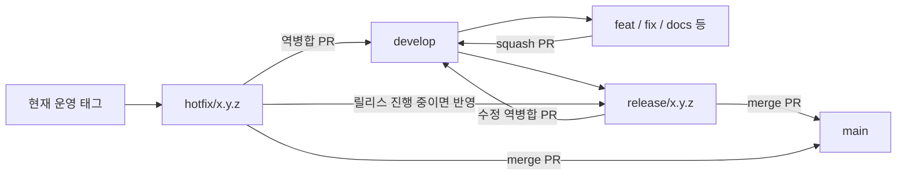

# 브랜치 전략

## 채택 모델

[Vincent Driessen의 Git Flow](https://nvie.com/posts/a-successful-git-branching-model/)를 기반으로 `main`·`develop`과 짧게 유지하는 작업·릴리스·긴급 수정 브랜치를 사용한다. 원문의 `master`는 이 저장소의 `main`에 대응한다. 릴리스 안정화와 다음 개발을 분리하고, 운영 수정이 다음 릴리스에서 누락되지 않도록 한다.

원문 저자는 2020년 회고에서 지속 배포하는 웹 서비스에는 더 단순한 흐름도 고려하도록 권한다. 이 프로젝트는 요청한 Git Flow를 적용하되 단일 운영 버전만 관리하고, 별도 장기 지원 브랜치나 Git Flow CLI는 도입하지 않는다. 릴리스 안정화 기간이 사라지고 상시 배포로 전환하면 모델을 재검토한다.

커밋·PR 작성은 [기여 규칙](../CONTRIBUTING.md), 변경 분할·의존 PR·리뷰는 [PR 전략](pr-strategy.md)을 함께 따른다. 이 문서는 브랜치의 역할과 이동 경로를 정한다.

## 브랜치 역할과 이름

| 브랜치 | 역할 | 분기 기준 | PR 병합 대상 | 병합 방식 |
|---|---|---|---|---|
| `main` | 운영 배포 가능한 릴리스 이력 | 기존 브랜치 유지 | 해당 없음 | 릴리스·긴급 수정 PR만 수용 |
| `develop` | 다음 릴리스의 개발 통합 | 기존 브랜치 유지 | 릴리스 분기 기준 | 작업 PR과 역병합 수용 |
| `feat/<이슈번호>-<설명>` | 기능 개발 | 최신 `develop` | `develop` | squash |
| `fix/<이슈번호>-<설명>` | 일반 버그 수정 | 최신 `develop` | `develop` | squash |
| `docs/…`, `refactor/…`, `tests/…`, `ci/…`, `chore/…` | 문서·구조·검증·유지보수 | 최신 `develop` | `develop` | squash |
| `release/<버전>` | 출시 범위 고정과 안정화 | 최신 `develop` | `main`, 이후 `develop` | merge commit |
| `hotfix/<버전>-<설명>` | 운영 장애 긴급 수정 | 현재 운영 태그 | `main`, `develop`, 진행 중인 `release/*` | merge commit |

이름은 소문자 영어와 하이픈을 사용한다. 예: `feat/222-youtube-guides`, `release/1.2.0`, `hotfix/1.2.1-token-refresh`. 이슈가 있으면 작업 브랜치 이름에 번호를 포함한다. 기존 이름은 강제로 바꾸지 않으며 신규 작업부터 적용한다. 브랜치 접두어는 커밋 타입을 대체하지 않는다.

`main`·`develop`은 삭제하거나 강제 push하지 않는다. 그 밖의 브랜치는 병합·역병합과 의존 PR 정리가 끝나면 삭제하고, squash 병합한 브랜치를 다음 작업에 재사용하지 않는다. 운영 릴리스는 한 번에 하나만 준비한다.



## 일반 작업

1. 최신 원격 정보를 가져와 `origin/develop`에서 목적별 브랜치를 만든다. 작업 중인 변경은 먼저 보존한다.
2. 한 목적의 코드·테스트·설정을 함께 작성하고 `develop` 대상 PR을 연다.
3. 관련 검증·리뷰·충돌 해결 후 squash 병합한다. 작성자 외 최소 1명의 승인을 받는다.
4. 의존 PR은 부모 브랜치를 base로 사용하고 부모 병합 전까지 Draft로 유지한다. 부모 병합 후 커밋 이동·base 변경·재검증은 PR 전략을 따른다.

```bash
git fetch origin
git switch -c feat/222-youtube-guides origin/develop
# 구현·검증·커밋 후 PR 생성
git push -u origin feat/222-youtube-guides
```

독립 PR의 기본 대상은 `develop`이다. 릴리스 안정화 수정은 해당 `release/*`에서 짧은 `fix/*` 브랜치를 만들고 그 릴리스 브랜치로 squash PR을 보낸다. 이 경우에도 리뷰와 검증을 생략하지 않는다.

## 정기 릴리스

1. 릴리스 담당자는 포함할 PR·이슈와 버전을 확정한다. 필요한 기능이 모두 `develop`에 들어온 뒤 `release/<버전>`을 분기한다. 아직 넣지 않을 기능이 섞였다면 먼저 범위를 정리하며, 개별 기능을 임의로 골라 운영에 올리지 않는다.
2. `release/*`에는 버그 수정·배포 설정·릴리스 메타데이터만 추가한다. 새 기능은 `develop`에서 다음 릴리스를 준비한다. 릴리스 분기 후 `develop` 전체를 다시 합치지 않는다.
3. `release/*` → `main` PR에서 포함 범위, 검증 결과, API·DB 전환, 배포·복구 방법을 확인하고 merge commit으로 병합한다. `develop` → `main` 직접 병합은 사용하지 않는다.
4. 병합된 `main` 커밋의 CI와 ECR 이미지 발행 성공을 확인한다. 해당 SHA에 annotated tag `v<버전>`을 붙인다. 태그는 검증한 커밋을 명시해 만들고 기존 태그를 이동하지 않는다.
5. Cloud 저장소 CD에서 같은 `main` SHA의 이미지를 배포하고 헬스 체크·핵심 API를 확인한다. 태그 생성이나 이 저장소의 병합만으로 운영 배포가 완료된 것으로 처리하지 않는다.
6. 같은 `release/*` → `develop` 역병합 PR을 merge commit으로 병합한다. 충돌이 있으면 담당자가 해결하고 갱신된 결과를 검증한다. 두 대상 반영과 배포 결과 기록 후 릴리스 브랜치를 삭제한다.

릴리스 PR은 배포를 위한 하나의 통합 목적이며, 개별 기능의 리뷰를 대체하지 않는다. 이슈 종료 처리는 저장소의 실제 기본 브랜치를 확인하고 PR 전략을 따른다.

## 운영 긴급 수정

1. 실제 운영 중인 태그·이미지 SHA를 확인해 `hotfix/<다음 PATCH 버전>-<설명>`을 만든다. `main`이 아직 운영에 배포되지 않은 릴리스를 포함할 수 있으므로 운영 기준을 추정하지 않는다.
2. 장애 해결에 필요한 최소 수정과 회귀 검증을 담는다. `main`에 미배포 변경이 있다면 함께 배포해도 되는지 먼저 판단하고 배포 범위를 정리한다. hotfix PR을 병합한다고 `main`의 다른 변경이 제외되지는 않는다.
3. `hotfix/*` → `main` PR을 리뷰·검증 후 merge commit으로 병합한다. 긴급 상황에서도 직접 push와 검사 우회를 기본 절차로 삼지 않는다.
4. 정기 릴리스와 동일하게 병합된 `main` SHA의 CI·이미지 발행을 확인하고 새 PATCH 태그와 Cloud CD로 배포·검증한다.
5. 같은 hotfix 브랜치를 `develop`에 merge commit PR로 역병합한다. 릴리스가 진행 중이면 해당 `release/*`에도 반영하고, 반영이 끝날 때까지 그 릴리스를 배포하지 않는다.
6. 모든 대상 반영을 확인한 뒤 hotfix 브랜치를 삭제한다.

원문은 진행 중인 릴리스에 먼저 역병합하고 이후 `develop`에 전파할 수 있게 한다. 이 프로젝트는 릴리스 취소·지연 시 누락을 막기 위해 `develop`과 진행 중인 릴리스 모두에 즉시 반영한다.

## 버전과 배포 추적

- 릴리스 브랜치는 `release/1.2.0`, Git 태그는 `v1.2.0` 형식이다. 예시 번호를 실제 첫 버전으로 간주하지 않는다. 첫 적용 시 기존 태그와 운영 이력을 확인해 다음 번호를 정한다.
- 호환성을 깨는 변경은 MAJOR, 호환 가능한 기능 추가는 MINOR, 수정은 PATCH를 올린다. 상세 변경 표기는 기여 규칙을 따른다.
- `build.gradle`의 현재 `0.0.1-SNAPSHOT`은 자동으로 릴리스 번호와 동기화되지 않는다. Git 태그와 배포 SHA를 릴리스 식별 기준으로 삼는다.
- 릴리스 기록에는 태그, `main` SHA, ECR 이미지 참조, 포함 PR, DB migration, 배포 결과를 남긴다. 이미지 태그는 기존의 전체 commit SHA 정책을 유지한다.
- 배포 실패 시 Cloud CD에서 직전 정상 이미지 SHA로 복구한다. DB·외부 계약이 이전 앱과 호환되는지 먼저 확인하며, 앱 롤백으로 DB migration까지 자동 복원된다고 가정하지 않는다. 데이터 변경은 [DB migration 절차](database-migrations.md)를 따른다.

## CI와 보호 설정의 적용

현재 작업 디렉터리의 `.github/workflows/ci.yml`은 `main`·`develop` push와 이 두 브랜치 대상 PR을 처리한다. 이미지는 push CI에서 SHA 태그로 발행하며 실제 운영 배포는 Cloud 저장소가 맡는다. `release/*`·작업 브랜치 대상 PR은 현재 필터에 포함되지 않는다.

따라서 릴리스 브랜치에서 수정 PR을 받을 때는 다음 적용 항목을 먼저 완료한다. 검사 미실행을 성공으로 간주하지 않는다.

| 적용 항목 | 필요한 설정·확인 |
|---|---|
| 릴리스 수정 PR 검사 | `pull_request.branches`에 `release/**` 추가. `main`·`develop`·`release/**` 대상 PR에 필요한 애플리케이션 빌드·테스트·DB 검사를 실행 |
| 이미지 발행 경계 | 기존 `main`·`develop` push 발행 유지. PR·`release/*`·`hotfix/*`만으로 운영 배포나 ECR 발행을 추가하지 않음 |
| 브랜치 보호 | `main`, `develop`, `release/**`에 PR 필수, 작성자 외 승인 1개 이상, 최신 변경 재승인, 미해결 대화·관련 필수 검사 통과 요구 |
| 이력 보호 | force push·삭제 금지. merge commit이 필요한 브랜치에는 선형 이력 강제를 사용하지 않음 |
| 병합 옵션 | squash와 merge commit 허용. 릴리스·hotfix·역병합 PR은 merge commit 선택. 자동 브랜치 삭제는 두 대상 반영·의존 PR 정리 전에 실행되지 않도록 운영 |
| 검사 이름 | 실제 PR에서 생성되는 job·check 이름을 확인해 등록. CI 필터·검사 내용 변경 시 함께 갱신 |

이 문서는 정책을 정의하며 원격 보호 설정과 CI 워크플로를 변경하지 않는다. 담당자는 위 설정을 적용·확인한 뒤 릴리스 안정화 흐름을 사용한다. 적용 전에는 `release/*` 대상 수정 PR에서 관련 검사를 로컬로 수행하고 결과를 기록하며, 최종 `main` 대상 PR의 검사도 확인한다.

기존 작업 브랜치와 열린 PR은 유지한다. 일반 작업은 계속 `develop`으로 통합하고, 다음 정기 배포부터 `release/*` 경로를 사용한다. 이력 재작성이나 기존 태그 이동은 전환에 필요하지 않다.
