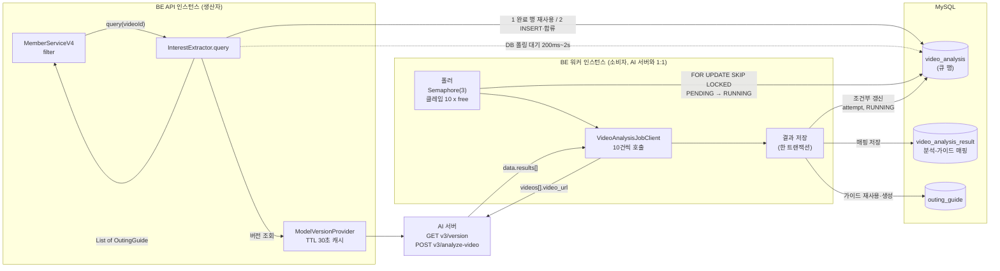
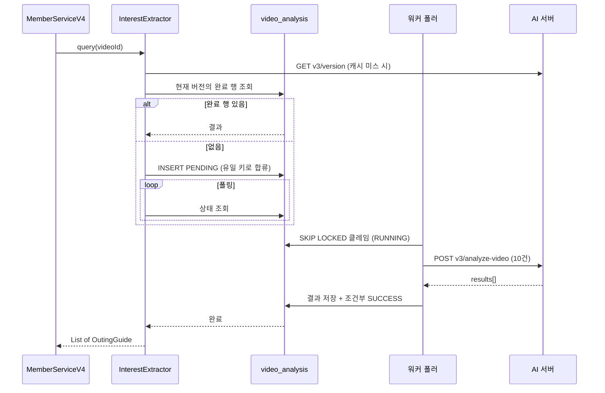
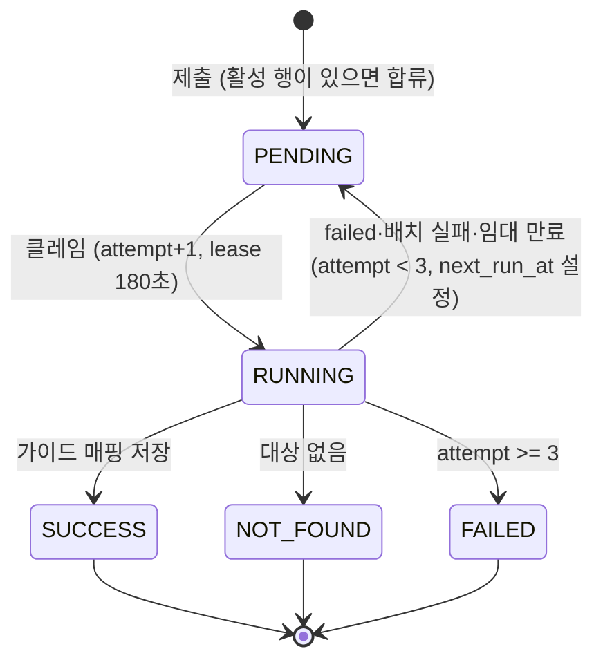

# DB 작업 큐 기반 영상 분석 설계 (실험)

기존 설계([ADR 0003](adr/0003-in-process-analysis-mysql-coordination.md), [ADR 0006](adr/0006-durable-youtube-sync-workers.md) 초안)와 별개로 `feat/db-analysis-queue` 워크트리에서 검증하는 실험이다. 성공하면 정식 채택하고, 그때 ADR로 기록한다. 이 문서는 2026-11-05 설계 인터뷰에서 합의한 내용이며 구현 전 확인용이다.

## 목표와 비목표

- 영상 분석을 DB 테이블을 큐로 쓰는 생산자/소비자 구조로 바꾼다. 브로커는 도입하지 않는다.
- 분석 결과는 영상과 분석 버전 단위로 시스템 전체가 공유한다.
- 정확히 한 번 실행, 전역 공정성, 엄격한 AI 호출 상한 초과 방지는 보장하지 않는다.

## 흐름

```text
MemberServiceV4.foo
  → YoutubeServiceV4.fetchLikedVideos
  → filter(likedVideos)                 // 별도 메서드, query와 무관
  → 영상마다 가상 스레드: InterestExtractor.query(videoId)
        1. 현재 분석 버전의 완료 행(SUCCESS/NOT_FOUND)이 있으면 그 결과를 반환
        2. 없으면 작업 행 INSERT(이미 활성 행이 있으면 합류), 폴링으로 대기
        3. 완료되면 List<OutingGuide> 반환 (대상 없음은 빈 리스트)
        4. 최종 실패·대기 타임아웃은 예외
  → OutingWishlistServiceV4 로 회원별 반영

소비자(폴러) ──▶ 남은 퍼밋 수 × 10 건 클레임 ──▶ 10건씩 AI 호출 ──▶ 결과 저장(한 트랜잭션)
```

## 구성도





## 분석 버전

- 분석 버전은 AI 서버 `GET v3/version`의 `data.commit`이다. 조회 결과는 짧은 TTL(초기 30초)로 캐시한다.
- 작업 행에는 제출 시점의 버전을 고정한다. 버전 조회에 실패하면 새로 제출하지 않고 예외로 실패한다. 만료 전 캐시 값이 있으면 그 값을 쓴다.
- **알려진 한계:** 분석 응답에 버전이 없으므로 제출 후 AI가 재배포되면 이전 커밋으로 기록될 수 있다. 문제가 관찰되면 호출 전후 버전 비교를 도입한다.
- 재사용 범위는 같은 버전의 `SUCCESS`·`NOT_FOUND`뿐이다. 다른 버전의 결과는 보존하되 재사용하지 않는다.

## 데이터 모델

`video_analysis` 행을 큐 행으로 진화시킨다. 영상 하나와 분석 버전 하나에 활성 행은 최대 하나다.

| 컬럼 | 설명 |
|---|---|
| `video_id`, `analysis_version` | 대상 영상과 제출 시점 분석 버전 |
| `status` | `PENDING`, `RUNNING`, `SUCCESS`, `NOT_FOUND`, `FAILED` |
| `attempt` | 클레임 때 1 증가. 소비자 사망·임대 만료도 시도로 센다 |
| `next_run_at` | 재시도 대기 종료 시각(DB 시간) |
| `lease_until`, `lease_owner` | 임대 만료 시각(DB 시간)과 소비자 식별자 |
| `failure_code`, `excluded_candidates`, `completed_at` | 기존 컬럼 유지 |
| `active_key` | 생성 컬럼. `PENDING`·`RUNNING`일 때만 `(video_id, analysis_version)`으로 채워지고 유일 인덱스를 건다 |

- 기존 `youtube_sync_id`와 `in_progress_video_id` 생성 컬럼·유일 키는 제거한다.
- `video_analysis_result`(분석-가이드 매핑)는 그대로 쓴다. 행이 영상·버전당 하나가 되어 재사용 판단이 단순해진다.
- 기존 이력은 마이그레이션에서 `analysis_version`을 고정 값으로 채운다. 이전 계약 이력(`completed_at` 없음)은 재분석 대상으로 둔다.
- `FAILED`는 활성 유일 키에서 빠지므로 다음 `query`가 새 행을 제출할 수 있다. 실패를 영구 캐시하지 않는다.

## 상태 전이와 재시도



- 영상별 `failed`, 배치 전체 실패(HTTP 오류·타임아웃·잘못된 응답), 임대 만료는 모두 같은 `attempt`로 센다. AI 오류 문자열은 구분하지 않고 모두 재시도 대상이다.
- 완료·실패·재시도 기록은 `WHERE id=? AND attempt=? AND status='RUNNING'` 조건부 갱신으로 처리한다. 임대가 만료된 이전 소비자의 늦은 쓰기를 거부한다.
- 임대는 연장하지 않는다. 임대 시간을 AI 호출 제한보다 길게 둔다.
- 모든 시각 비교는 DB 시간을 쓴다.

## 소비자

- 폴러 하나가 워커 내부 `Semaphore(3)`의 남은 퍼밋 수 `free`를 확인하고 `FOR UPDATE SKIP LOCKED`로 최대 `10 × free`건을 클레임한다. C=3이므로 최대 30건이다.
- 10건씩 나눠 퍼밋당 한 번 `POST /v3/analyze-video`를 호출한다. 배치를 채우려고 기다리지 않고 준비된 것만으로 바로 호출한다.
- 요청은 `video_url`만 보낸다. `upload_date`·`title`·`description`은 선택이므로 null로 보낸다.
- 임대 만료 행은 폴링 때 `PENDING`으로 되돌린다.

## 결과 저장

한 트랜잭션에서 다음을 수행한다.

1. 후보를 검증한다(`OutingGuideCandidateValidator`).
2. 이미 있는 가이드는 재사용하고 없으면 생성해 영속화한다(`GuideKey` 동일성).
3. `(분석, 가이드)` 매핑을 저장한다.
4. 조건부 갱신으로 작업을 `SUCCESS`/`NOT_FOUND`로 바꾼다.

유일 키·교착 충돌은 기존 `YoutubeSyncBatchWriter`의 재시도(errno 1062/1205/1213) 방식을 재사용한다.

## 대기와 타임아웃

- 대기자는 가상 스레드에서 행 상태를 폴링한다. 간격은 200ms에서 2초까지 늘린다. 다른 인스턴스에서 완료될 수 있으므로 DB 폴링이 기준이다.
- 대기 타임아웃은 10분이다. 타임아웃은 대기자만 포기한다. 작업은 계속되어 이후 `query`가 완료된 이력을 재사용한다.
- 최종 실패와 타임아웃은 예외로 구분해 던진다. 구체 타입은 `docs/exception-handling.md`를 따른다.

## 설정 기본값

모두 설정 값이며 실험하며 조정한다.

| 항목 | 초기값 |
|---|---|
| AI 동시 호출 수 C | 3 |
| 호출당 영상 수 | 10 |
| 최대 시도 횟수 | 3 |
| 백오프 | 2초 → 5초 (±지터) |
| 임대 | 180초 |
| AI 호출 제한 | 130초 (연결 5초) |
| 대기 타임아웃 | 10분 |
| 대기 폴링 | 200ms → 2초 |
| 소비자 빈 큐 폴링 | 1초 |
| 버전 캐시 TTL | 30초 |

## 변경 범위 (현재 코드 기준)

격리된 워크트리에서 급진적으로 갈아엎는다. 기존 구현과의 충돌은 정식 채택 시 통합하면서 해결한다. 따라서 호환성 유지와 점진적 이행은 목표가 아니다.

| 분류 | 대상 |
|---|---|
| 재사용 | `video_analysis_result`와 엔티티·저장소, `VideoAnalysisJobClient`·`VideoAnalysisResponse`·`AiRequestException`, `OutingGuideCandidateValidator`, `OutingGuideFactory`, `GuideKey`, `BatchAnalysis.from`, `outing_guide`와 유일 키 |
| 수정 | `VideoAnalysis`·`VideoAnalysisStatus`·`VideoAnalysisRepository`, 가이드 해석·매핑(`YoutubeSyncBatchCommitService`에서 추출), 재시도(`YoutubeSyncBatchWriter`에서 추출), v4 클래스 4종 구현 |
| 제거 | 기존 동기화 스택 전체: `YoutubeSyncCoordinator`·`YoutubeSyncService`·`YoutubeSyncBatchProcessor`·`YoutubeSyncBatchCommitService`(추출 후)·`YoutubeSync*` 엔티티·저장소와 heartbeat·sweeper·fencing, v2·v3 동기화 컨트롤러와 SSE |
| 제거 | `SharedVideoAnalysisService`, `VideoAnalysisManager`, 레거시 v2 분석 경로(`DefaultYoutubeVideoAnalyzer`, `InterestExtractionServiceV2`, 구 V2 요청·응답 DTO, `AiServerService`), `video_analysis.youtube_sync_id`, `uk_video_analysis_in_progress_video`와 하드코딩된 키 이름 |
| 제거 | AI 호출 게이트웨이·슬롯 전체(`ai_call_slot` 테이블, `AiCallSlot*`, `AiCallType`, `AiCallGateway`, `DefaultAiCallGateway`, `AiCallProperties`)와 임베딩 경로(`EmbeddingOutboxPoller`, `submitEmbedding`, `embedding_outbox`와 가이드 생성 시 적재 호출). 정확한 범위는 3단계에서 코드로 확정한다 |

YouTube 연동(계정 연결·해제·조회) 관련 코드는 동기화와 무관하므로 건드리지 않는다. 회원 동기화의 진척도·SSE·회원당 활성 동기화 보장은 이번 실험 범위에서 빠지며, 통합 시 새 흐름 위에서 다시 설계한다.

## AI 동시성 게이트

- AI 서버 인스턴스 하나의 동시 분석 한도는 3이다. 요청마다 큐를 두지 않고 `video_analysis` 테이블이 유일한 중앙 큐다. 기존 동기화별 라운드 로빈 큐는 없앤다.
- 생산자(`InterestExtractor.query`까지)는 BE API 인스턴스에서, 폴러 이후(클레임·AI 호출·결과 저장·재시도)는 별도의 BE 워커 인스턴스에서 실행한다. 두 인스턴스는 `video_analysis` 테이블로만 통신한다.
- AI 서버 인스턴스와 BE 워커는 1:1이고 로드밸런서는 없다. 호출 주체가 워커 하나뿐이므로 DB 슬롯(`ai_call_slot`)은 쓰지 않고 워커 내부 `Semaphore(3)`로 동시 호출을 제한한다. `free`는 남은 퍼밋 수이며 클레임 크기는 `10 × free`다.
- 워커 AI 주소는 인스턴스별 설정(`keepgo.clients.ai.address`)이다.
- **알려진 한계:** 워커 재시작 직후 AI 서버가 이전 호출을 처리 중이면 동시 호출이 일시적으로 3건을 넘을 수 있다.

## 구현 순서

각 단계는 컴파일과 해당 단계 테스트가 통과하는 하나의 커밋으로 남긴다.

1. `docs`: 이 설계 문서와 용어집
2. `refactor`: 가이드 해석·매핑과 충돌 재시도를 기존 커밋 서비스·라이터에서 독립 컴포넌트로 추출
3. `refactor`: 기존 동기화 스택, 레거시 v2 분석 경로, AI 게이트웨이·슬롯, 임베딩 경로 제거(관련 테스트 포함)
4. `feat(mysql)`: 마이그레이션. `video_analysis` 큐 컬럼·상태 변경, 유일 키 교체, 기존 행 백필
5. `feat(ai)`: `/v3/analyze-video`(`videos[]`) 클라이언트 전환과 분석 버전 조회(`ModelVersionProvider`)
6. `feat`: 생산자. 이력 재사용·제출·합류·대기
7. `feat`: 소비자. `Semaphore(3)`·클레임·호출·결과 저장·재시도·임대 만료 회수
8. `feat`: `InterestExtractor`·`MemberServiceV4` 연결과 흐름 테스트

마이그레이션과 엔티티·enum 변경은 같은 커밋에서 컴파일이 깨지지 않도록 3~4단계에 걸쳐 맞춘다.

## 검증

- 큐 핵심(클레임 경쟁, 임대 만료 회수, 유일 키 합류, 조건부 갱신)은 실제 MySQL 통합 테스트로 검증한다. 기존 `mysqlIntegrationTest` 소스셋과 `MySqlIntegrationTestSupport`를 따른다(Testcontainers는 이 저장소에 없다).
- 소비자 로직은 가짜 AI 클라이언트로 검증한다.
- 단위 테스트만으로 트랜잭션·잠금을 증명했다고 보지 않는다.
