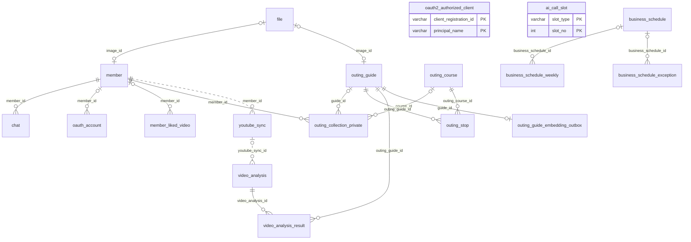
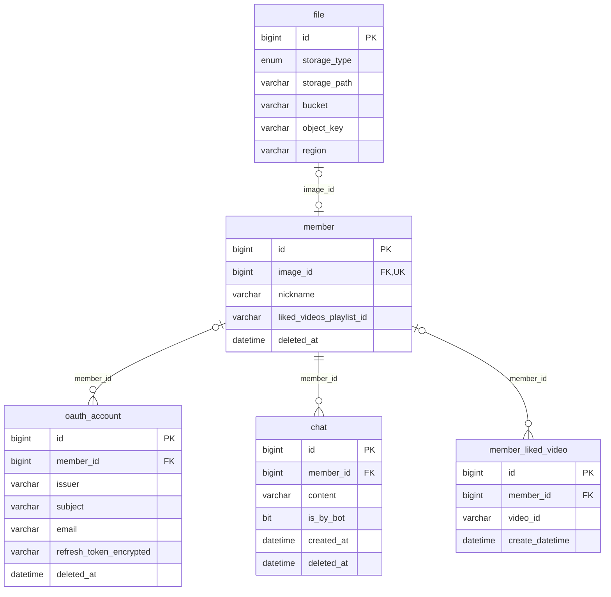
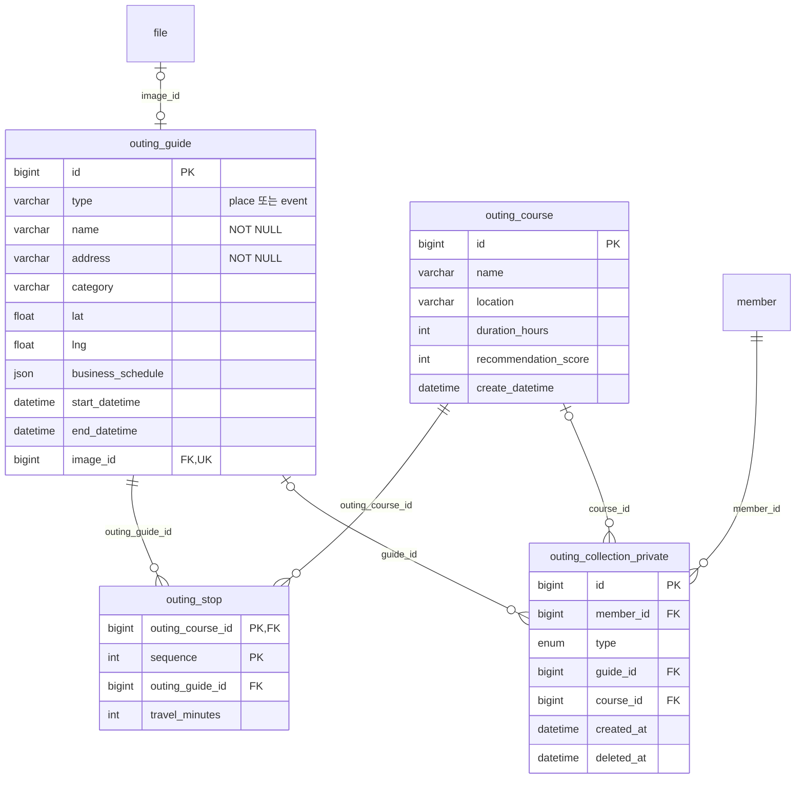
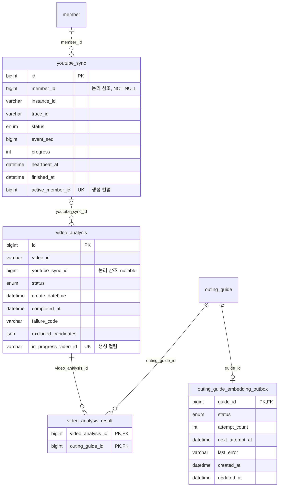
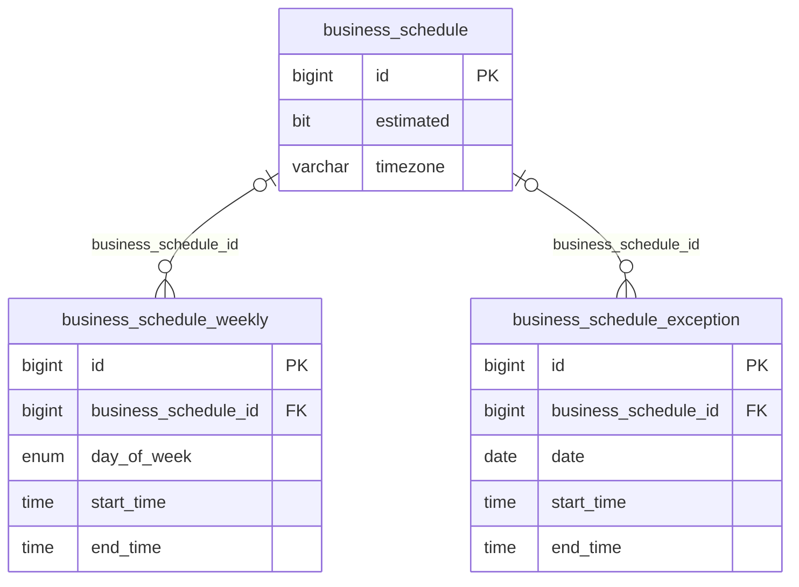

# KeepGo ERD

## 기준과 읽는 방법

2026-11-01 현재 작업 트리의 JPA 매핑과 Flyway **V1~V9를 모두 적용한 스키마**를 문서화한다. 운영 DB에서 스키마를 조회한 결과가 아니므로 실제 배포 상태와 같다고 가정하지 않는다. 스키마 비교·적용 절차는 [DB 마이그레이션](database-migrations.md)을 따른다.

용어는 [도메인 용어집](../GLOSSARY.md)을 따른다. **나들이 대상**의 구현명은 `OutingGuide`이며, 물리 테이블은 `outing_guide`다. 위시리스트 항목의 구현명은 `OutingWishlistEntry`지만 물리 테이블명은 `outing_collection_private`로 남아 있다.

- 실선 `--`은 DB FK, 점선 `..`은 FK 없는 논리적 ID 참조다. Mermaid의 식별 관계 구분 대신 이 문서의 FK 유무 표기로 사용한다.
- `||`는 정확히 하나, `o|`는 0 또는 1, `o{`는 0개 이상이다. 선택 여부는 DB nullable을 기준으로 한다. 논리 참조는 애플리케이션 의도를 표현하며 DB가 존재를 보장하지 않는다.
- 상세도의 컬럼은 PK·FK·주요 상태와 제약 중심으로 추렸다. 전체 DDL은 [마이그레이션 소스](../src/main/resources/db/migration/)를 참조한다.
- `PK`, `FK`, `UK`는 각각 기본 키, 외래 키, 유일 키다. 복합 키는 아래 설명을 함께 읽는다.

## 전체 관계도

기존 영업시간 테이블의 FK는 nullable이다. ID 할당·이관 보고 테이블은 아래 별도로 나열한다.

## 회원·인증·채팅

| 테이블 | 역할과 주요 제약 |
| --- | --- |
| `member` | 회원. 프로필 이미지는 선택 사항이며 `image_id`는 유일하다. 삭제는 `deleted_at`으로 표현한다. |
| `file` | LOCAL/S3 파일 위치. 회원 이미지와 나들이 대상 이미지의 유일 제약은 각 참조 테이블별이므로, 두 테이블 사이의 같은 파일 공유까지 금지하지 않는다. |
| `oauth_account` | 로그인 계정 정보. `member_id`는 nullable이며 `(issuer, subject)`에 DB 유일 제약은 없다. |
| `chat` | 회원과 봇의 채팅 기록. `member_id` 필수. |
| `member_liked_video` | 회원의 좋아요 영상 기록. 영상 ID는 외부 YouTube 식별자이며 영상 마스터 FK가 아니다. `(member_id, video_id)` 유일 제약은 없다. |
| `oauth2_authorized_client` | Spring Security JDBC OAuth 클라이언트 저장소. 복합 PK `(client_registration_id, principal_name)`. 접근·갱신 토큰과 발급·만료 시각을 저장한다. 회원 FK는 없으며 로그인 계정 테이블과 별도 저장소다. |

## 나들이 대상·코스·위시리스트

- 장소 `OutingPlace`와 행사 `OutingEvent`는 `SINGLE_TABLE` 상속이다. 별도 장소·행사 테이블 없이 `outing_guide.type`의 소문자 `place`/`event`로 구별한다. 행사 기간은 `start_datetime`, `end_datetime`, 영업 일정은 `business_schedule` JSON에 담는다.
- V8부터 `(type, name, address)`가 복합 UK이며 세 컬럼은 NOT NULL, `utf8mb4_0900_bin`이다. 이름·도로명주소가 같아도 유형이 다르면 다른 대상이다. 반복 행사 회차는 분리하지 않는다([ADR 0001](adr/0001-guide-identity-and-recurring-events.md)). JPA의 nullable 선언만으로 이 제약을 판단하면 안 된다.
- `outing_stop`의 PK는 `(sequence, outing_course_id)`다. 코스 안에서 방문 순서는 중복되지 않지만 같은 대상의 재방문은 가능하다. 코스·대상 FK는 모두 필수다.
- 위시리스트 항목 팩토리는 대상 또는 코스 중 하나를 선택한다. **DB에는 두 FK의 XOR CHECK가 없다.** 둘 다 NULL이거나 둘 다 있는 행을 DB 제약만으로 막지 못한다.
- 위시리스트 `type`은 `PLACE`, `EVENT`, `OUTING_COURSE`, `OUTING_WISHLIST_SHARED`를 허용한다. 이 enum 값이 있다고 별도 공유 위시리스트 테이블이 존재하는 것은 아니다.
- 회원별 대상·코스 유일 제약은 없다. V8은 기존 활성 회원·대상 중복을 정리하지만 이후 삽입을 막는 UK를 추가하지 않는다. 항목 삭제는 `deleted_at`을 기록하며 대상·코스 자체의 삭제와 구별한다.
- 나들이 조건 `OutingCriteria`는 `OutingCriteriaRepository`의 Spring Cache에 저장하므로 이 MySQL ERD의 테이블에 포함하지 않는다.

## YouTube 동기화·공유 분석·임베딩

| 테이블 | 상태·주요 제약 |
| --- | --- |
| `youtube_sync` | `QUEUED`, `RUNNING`, `SUCCEEDED`, `FAILED`. 생성 컬럼 `active_member_id`는 QUEUED/RUNNING일 때만 `member_id`이고 나머지는 NULL이다. UK로 회원당 진행 중 동기화를 하나로 제한한다. 조회·대상·분석·실패 건수, 진행률, 이벤트 순번을 저장한다. |
| `video_analysis` | `IN_PROGRESS`, `SUCCESS`, `NOT_FOUND`, `FAILED`. V9의 생성 컬럼 `in_progress_video_id`는 IN_PROGRESS일 때만 `video_id`이며 나머지는 NULL이다. UK로 동일한 비NULL 영상 ID의 진행 중 분석을 전체 회원에서 하나로 제한한다. 원본 `video_id`는 nullable이므로 NULL ID의 행까지 하나로 제한하지는 않는다. |
| `video_analysis_result` | 분석과 대상의 N:M 중간 테이블. 복합 PK `(outing_guide_id, video_analysis_id)`로 동일 조합의 중복을 막는다. SUCCESS에 반드시 결과 행이 존재하는 것까지 DB가 보장하지는 않는다. |
| `outing_guide_embedding_outbox` | `PENDING`, `FAILED`. `guide_id`가 PK 겸 FK이므로 대상당 최대 한 행이다. 대상 삭제 시 `ON DELETE CASCADE`. 다음 시도 시각과 시도 횟수를 저장한다. |
| `ai_call_slot` | 복합 PK `(slot_type, slot_no)`. `holder`, `leased_until`로 AI 호출 슬롯을 임대하는 JDBC 조정 테이블이며 도메인 테이블 FK는 없다. |

영상 분석 결과는 회원에 귀속되지 않고 공유한다. `youtube_sync_id`는 분석을 시작한 동기화이며 결과를 이용한 모든 동기화의 목록이 아니다. 재사용·합류 시 참여자별 분석 이력을 추가하지 않는다. 회원별 저장·삭제 의사는 위시리스트 항목으로 구별한다. [ADR 0004](adr/0004-shared-video-analysis-results.md)를 참조한다.

V9의 생성 영상 ID는 `utf8mb4_0900_bin`이다. V9는 원본 `video_id`의 collation까지 변경하지 않는다. 영상별 완료 이력을 하나로 제한하는 UK도 없다. `completed_at`과 ID로 최신 결과를 선택하는 것은 애플리케이션 처리다.

주요 조회 인덱스는 동기화의 `(member_id, finished_at)`, `(instance_id, status)`, `(status, heartbeat_at)`, 분석의 `youtube_sync_id`, `video_id`, 아웃박스의 `(status, next_attempt_at)`이다. Heartbeat, fencing, 슬롯, 아웃박스의 역할은 [ADR 0003](adr/0003-in-process-analysis-mysql-coordination.md)을 참조한다.

## 기존 모델·운영 보조 테이블

이 세 테이블은 V1에 있지만 현재 JPA 엔티티에는 대응하지 않는다. `outing_guide`와 FK 관계도 없다. 현재 사용하는 `business_schedule` JSON과 구별한다.

| 보조 테이블 | 용도·키 |
| --- | --- |
| `outing_guide_dedup_map` | V8의 기존 ID·대표 ID·이미지 ID 보고. PK `guide_id`, 인덱스 `representative_id`. 삭제된 ID를 포함하므로 FK가 없다. 대표 행 자신의 대응도 기록한다. |
| `outing_guide_dedup_invalid` | V8이 감지한 잘못된 이름·주소와 참조 건수. PK `guide_id`, FK 없음. |
| `*_seq` | JPA ID 할당용이며 `next_val`을 저장한다. V1의 `business_schedule`, `business_schedule_exception`, `business_schedule_weekly`, `chat`, `file`, `member`, `member_liked_video`, `oauth_account`, `outing_collection_private`, `outing_course`, `outing_guide`, `video_analysis`와 V2의 `youtube_sync`에 대응하는 13개 테이블이다. |
| `flyway_schema_history` | Flyway 활성화 시 생성하는 마이그레이션 이력. 업무 FK 관계에는 포함하지 않는다. |

V8의 `outing_guide_dedup_guard`, `video_analysis_result_dedup`은 이관 중 사용하는 작업 테이블이며 정상 종료 시 삭제된다. `dedup_map`, `dedup_invalid`는 자동 삭제하지 않으며 후속 운영 절차에서 제거될 수 있다.

## 업데이트 시 확인할 소스

1. [V1~V9 DDL](../src/main/resources/db/migration/)에서 FK, nullable, 복합 키, 생성 컬럼을 확인한다.
2. [회원](../src/main/java/eightjbbm/keepgo/member/entity/), [추천](../src/main/java/eightjbbm/keepgo/recommendation/entity/), [위시리스트 항목](../src/main/java/eightjbbm/keepgo/outingwishlist/application/domain/model/OutingWishlistEntry.java), [동기화](../src/main/java/eightjbbm/keepgo/interestextraction/repository/youtubesync/) 매핑과 대조한다.
3. DB와 애플리케이션의 보장을 구별하고 기존 [ADR](adr/)·용어집에 맞춰 문서를 갱신한다. 이번 문서화는 새로운 설계 결정이나 DB 변경을 포함하지 않는다.
