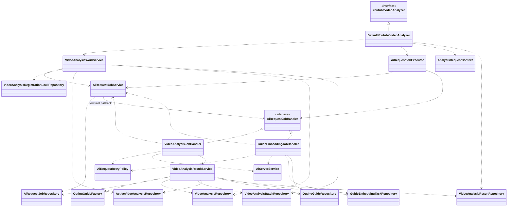
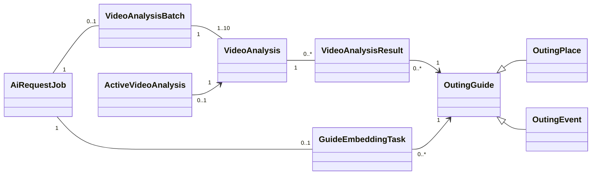

# YouTube 영상 분석 리팩토링 구현 계획

작성일: 2026-10-28
대상: `DefaultYoutubeVideoAnalyzer#analyze`
기준: 사용자 제공 `refactor-youtube-sync.md` 및 클래스 설계 논의
범위: 구현 전 구조와 순서 정의. 이 문서 작성에서는 애플리케이션 코드를 변경하지 않는다. 구현 범위에는 V2·V3 분석 경로 통합, 상위 동기화 서비스의 트랜잭션 경계, 특정 호출 추적 계약, 전체 Guide 쓰기 경로 전환 및 이관·배포 검증을 포함한다.
검토 상태: Q1~Q22의 설계 결정을 채택했다. 외부 호환성·운영 데이터 확인은 11절의 검증 조건으로 관리하며 지원 여부를 가정하지 않는다.
관련 결정: [Guide 동일성과 반복 행사](adr/0001-guide-identity-and-recurring-events.md), [DB 기반 AI Job 실행](adr/0002-durable-ai-jobs.md).

## 1. 설계 방향

영상 분석과 임베딩의 실행 상태는 공통 `AiRequestJob`으로 관리한다. Job 한 건은 재시도와 소유권 인계를 포함하는 논리적 작업이다. 영상별 업무 결과는 `VideoAnalysis`에 별도로 기록한다. 영상별 실패가 섞인 정상 응답을 모두 저장했다면 Job은 COMPLETED가 될 수 있다.

클래스는 메서드 수가 아니라 책임·트랜잭션·실행 수명으로 구분한다. 단순 변환·검증·결과 통합은 담당 클래스 내부 메서드로 구현한다. 기존 클래스도 수정·대체 대상으로 본다.

반환형은 `List<OutingGuide>`를 유지한다. 재사용 결과와 성공적으로 저장한 결과를 GuideKey로 중복 제거해 반환하며 순서는 보장하지 않는다. 일부 실패 시 성공 결과를 유지하고, 결과가 없으면 빈 목록을 반환한다. 호출자 대기 제한·중단 시에도 저장된 성공 결과를 부분 반환하고 컨텍스트로 대기 종료 상태를 전달한다. 결과 조회 장애는 제한 재시도 후 예외로 전달한다. 임베딩 완료는 기다리지 않는다.

## 2. 전체 클래스 목록

### 서비스 및 외부 연동

| 클래스 | 책임 | 주요 메서드 예시 |
|---|---|---|
| YoutubeVideoAnalyzer | 분석 진입 계약 | analyze |
| DefaultYoutubeVideoAnalyzer | 입력 검사·중복 제거, 작업 확보, 실행 요청, 완료 대기, 결과 통합 | analyze, prepareVideoIds, collectGuides |
| VideoAnalysisWorkService | 최신 이력 재사용·활성 작업 공유·신규 등록 결정, 등록 경쟁 제어, 최대 10개 배치 구성 | resolveWorks, registerBatch |
| AiRequestJobService | Job 등록, 실행권·호출 예산·재시도·만료 복구·최종 종료 | register, tryAcquire, renewLease, recordAttempt, scheduleRetry, recoverExpired, fail |
| AiRequestJobExecutor | 대기 Job 실행, 유형별 병렬도 관리, heartbeat·기한 처리 구동 | requestExecution, dispatchPending |
| AiRequestJobHandler | 유형별 실행 및 최종 실패 업무 처리 계약 | supports, execute, onFinalFailure |
| AiRequestRetryPolicy | 오류 분류 및 Retry-After·backoff·jitter 계산 | isRetryable, calculateDelay |
| VideoAnalysisJobHandler | 분석 호출, 응답 변환·후보 검증, 저장 재시도 조율 | execute, mapResponse, validateCandidates, saveWithRetry, onFinalFailure |
| VideoAnalysisResultService | 결과 원자 저장, 최종 실패 시 미완료 분석 종료와 활성 등록 해제 | commit, failUnfinished |
| GuideEmbeddingJobHandler | 임베딩 호출 및 완료·실패 처리 | execute, onFinalFailure |
| AiServerService | Job 전용 HTTP 클라이언트로 분석·임베딩 연동, 상태·헤더·원인 보존. 자체 재시도 없음 | analyzeVideoV2, embedPlaces |
| OutingGuideFactory | 유효 후보를 Place/Event로 생성 | create |

기존 `analyze(videos)`와 `List<OutingGuide>` 반환형을 유지하고, 상위 코드가 생성한 `AnalysisRequestContext`를 받는 내부 오버로드 `analyze(videos, context)`를 추가한다. 컨텍스트에 호출 ID와 생성·공유·재사용한 고정 분석 ID 및 작업 참조를 기록한다. 상위 코드는 해당 ID로 결과를 조회하며 로그는 보조 추적 수단이다.

완료 대기는 진입 서비스 내부 기능으로 시작한다. 이번 호출에 고정된 분석 ID를 조회하고, 대기 취소를 Executor의 작업 취소로 전파하지 않는다. 공통 실행 계층은 분석 전용 DTO에 의존하지 않는다.

### 엔티티

| 클래스 | 책임·주요 데이터 |
|---|---|
| AiRequestJob | 유형·상태, DB 등록 시각·실행 기한, 소유자·실행 버전, heartbeat/lease, 누적 호출 횟수·다음 재시도 시각·실패 정보 |
| VideoAnalysisBatch | 영상 배치 구성과 Job 연결. 실행 상태·소유권은 Job에서만 관리 |
| VideoAnalysis | 영상 ID·배치 소속·상태·생성/완료 시각·실패/제외 정보 |
| ActiveVideoAnalysis | 영상 ID를 PK로 하는 활성 분석 연결 |
| VideoAnalysisRegistrationLock | 정확한 영상 ID를 PK로 하는 영구 등록 잠금 행 |
| VideoAnalysisResult | 분석 이력과 모든 추출 Guide 연결 |
| OutingGuide | Guide 공통 데이터와 동일성 |
| OutingPlace | 장소 도메인 |
| OutingEvent | 행사 도메인. 기간·회차는 동일성에서 제외 |
| GuideEmbeddingTask | Job과 대상 Guide 연결. 실행 상태는 중복 보관하지 않음 |

초기 임베딩은 Guide 한 개당 Job 한 개로 구성한다. 여러 Guide의 호출 묶음 최적화는 후속 확장으로 둔다.

### DTO·값 객체·컨텍스트·Enum

| 분류 | 클래스 | 책임 |
|---|---|---|
| 내부 DTO | AnalysisWorkReference | 영상·분석·배치·Job ID와 생성/공유/재사용 구분 전달 |
| 내부 DTO | BatchAnalysisOutcome | 배치의 영상별 해석 결과 전달 |
| 내부 DTO | VideoAnalysisOutcome | 영상별 상태·유효 후보·실패·제외 정보 전달 |
| 내부 DTO | GuideCandidate | 저장 전 Guide 데이터 전달 |
| 외부 DTO | AnalyzeVideoResponseV2 | 버전이 구분된 영상 ID·상태·명시적 유형의 복수 Guide 계약을 매핑. 실제 wire 계약은 외부 호환성 검증 대상 |
| 예외 | AiRequestException | 비정상 HTTP 상태·Retry-After·전송 및 타임아웃 원인 전달 |
| 값 객체 | GuideKey | 유형·이름·도로명주소 동일성, hashCode, 고정 정렬 순서 |
| 값 객체 | ExecutionToken | Job ID·소유자 ID·실행 버전으로 실행권 식별 |
| 값 객체 | AiRequestFailure | 공통 작업 실패 코드와 사유 |
| 값 객체 | AnalysisFailure | 영상별 실패 코드와 사유 |
| 복합키 | VideoAnalysisResultId | 분석 ID·Guide ID |
| 컨텍스트 | AnalysisRequestContext | 상위 코드가 생성하며 호출 ID·고정 분석 ID·작업 참조·대기 종료 상태 보관 |
| Enum | AnalysisWaitStatus | COMPLETED, WAIT_TIMEOUT, INTERRUPTED |
| Enum | AiRequestJobType | VIDEO_ANALYSIS, GUIDE_EMBEDDING |
| Enum | AiRequestJobStatus | PENDING, IN_PROGRESS, COMPLETED, FAILED |
| Enum | VideoAnalysisStatus | IN_PROGRESS, SUCCESS, NOT_FOUND, FAILED |
| Enum | GuideType | PLACE, EVENT |
| Enum | AiRequestFailureCode | 호출 오류·타임아웃·기한 초과·저장 실패 등 |
| Enum | AnalysisFailureCode | 영상별 실패·INVALID_GUIDE_DATA·기한 초과 등 |

DTO는 경계 간 데이터 전달, 값 객체는 의미·규칙, 컨텍스트는 호출 추적 상태 보관이 목적이다. 호출별 상세 AiRequestAttempt는 초기 필수 클래스에서 제외한다.

### Repository·설정

| 클래스 | 책임 |
|---|---|
| AiRequestJobRepository | Job 저장·잠금·실행 대상 조회·조건부 갱신·DB 시간 비교 |
| VideoAnalysisBatchRepository | 배치 구성 저장·조회 |
| VideoAnalysisRepository | 이력 저장·영상별 최신 이력 일괄 조회·지정 ID 조회 |
| ActiveVideoAnalysisRepository | 활성 조회·등록 경쟁 식별·해당 분석 조건부 해제 |
| VideoAnalysisRegistrationLockRepository | 영상 ID 순서로 잠금 행 생성·획득 |
| VideoAnalysisResultRepository | 매핑 저장·지정 분석 ID들의 Guide 조회 |
| OutingGuideRepository | 키 조회·기존 필드를 보존하는 원자적 생성/충돌 처리 |
| GuideEmbeddingTaskRepository | Job별 임베딩 대상 저장·조회 |
| AiRequestJobProperties | 유형별 병렬도·기한·호출 타임아웃·재시도, heartbeat·lease·DB 타임아웃 |
| YoutubeAnalysisProperties | 분석 배치 크기·저장 교착상태 재시도·호출자 대기 제한·결과 조회 재시도 |
| AiRequestJobConfig | AI 실행·heartbeat·dispatch/recovery 실행기 분리, Handler 및 Job 전용 HTTP 클라이언트 등록 |

ActiveVideoAnalysisRepository는 재사용 여부를 판단하지 않는다. 판단과 등록 트랜잭션은 WorkService가 담당한다. 활성 해제는 영상 ID와 분석 ID 모두 일치할 때 수행하고 Job 실행권도 검증한다.

기존 VideoAnalysisManager는 작업 확보·공통 실행·결과 저장으로 분해한다. YoutubeVideoValidator는 다른 사용처 확인 후 진입 서비스 내부 검사로 통합한다. 공통 AI 실행은 분석 전용 클래스에 직접 의존하지 않는 패키지에 배치한다. 구체적인 패키지명과 메서드명은 기존 관례에 맞춘 구현 세부사항으로 둔다.

## 3. 주요 클래스 관계

Job은 유형에 따라 분석 배치 또는 임베딩 대상 중 하나에 연결한다. 다이어그램은 주요 서비스와 영속 관계이며 DTO·설정의 모든 의존성을 표시하지 않는다.

## 4. 작업 확보·대기·반환

1. 입력 검사·영상 ID 중복 제거. 전체 입력 수에는 10개 제한을 적용하지 않는다.
2. 활성 작업을 먼저 확인한다. 없으면 생성 시각·ID 기준 최신 완료 이력을 판단한다.
3. SUCCESS의 모든 Guide와 NOT_FOUND의 빈 결과를 재사용한다. 오래된 성공으로 대체하지 않는다.
4. FAILED 또는 이력 없음은 신규 후보로 판단하고 등록 트랜잭션에서 재검증한다.
5. 확보한 신규 영상만 최대 10개씩 배치 구성한다. 경쟁 패배 시 활성 작업과 완료 이력을 다시 조회한다.
6. 커밋 후 실행 요청한다. 커밋 후 제출 전 종료돼도 PENDING에서 복구한다.
7. 호출자 대기 제한 안에서 컨텍스트에 고정한 분석 ID들의 종료를 기다린다. 공유 작업이 실패해도 같은 호출에서 새 분석을 생성하지 않는다.
8. 재사용 결과와 반환 시 조회한 저장된 성공 결과를 GuideKey로 중복 제거해 반환한다. 대기 종료 상태는 컨텍스트로, 영상별 상세 상태는 고정 분석 ID의 저장 이력으로 확인한다.

### 호출자 대기 정책

`analyze` 진입부터 단조 시계로 기본 60초 예산을 계산한다. 입력 준비·등록에 소비한 만큼 결과 대기 시간이 줄어든다. 전체 입력에 상한이 없으므로 모든 입력 준비·등록과 최종 DB 조회까지 포함한 메서드 전체의 60초 반환을 보장하지 않는다. 예산 만료만으로 남은 입력의 등록을 생략하지 않으며, 등록한 Job의 기한이나 생존에도 영향을 주지 않는다. 각 등록·조회 DB 작업은 5절의 유한한 타임아웃을 적용한다.

상위 코드가 생성한 컨텍스트에는 작업 참조를 확보할 때마다 기록한다. 등록 도중 DB 오류가 나면 예외를 전달하고 남은 등록을 중단하되 이미 커밋된 Job은 취소하거나 롤백하지 않는다. 요청 전체를 하나의 등록 트랜잭션으로 묶지 않는다.

정상 반환의 대기 종료 상태는 컨텍스트의 `COMPLETED / WAIT_TIMEOUT / INTERRUPTED`로 전달한다. `COMPLETED`는 고정 분석 ID들이 모두 종료되었다는 뜻이며 모두 성공했다는 뜻은 아니다. 영상별 SUCCESS·NOT_FOUND·FAILED는 해당 ID의 이력으로 구분한다.

- 대기 제한 시 저장된 성공 결과를 부분 반환한다. 정상 최종 조회에서 분석 상태와 Guide 매핑을 같은 일관된 스냅샷으로 읽고 반환 결과와 대기 종료 상태를 확정한다. 그 조회 이후 커밋된 결과는 이번 반환에 포함하지 않는다.
- 인터럽트 시 새 blocking DB 조회를 강제하지 않고 마지막으로 성공한 조회 결과를 반환한다. 재사용 결과도 조회 스냅샷에 포함해 유지한다. `INTERRUPTED`를 기록하고 호출자 스레드의 인터럽트 플래그를 복원하며 AI worker는 취소하지 않는다.
- DB 결과 조회는 최초 1회와 최대 2회 재시도한다. 소진 시 캐시된 부분 결과나 빈 목록으로 대체하지 않고 예외를 전달한다. 커밋된 분석과 실행 중 Job은 유지한다. 예외로 끝난 호출에 정상 반환용 대기 상태를 억지로 부여하지 않는다.
- 대기 polling은 500ms이며 재조회·재시도도 유한하다. 호출자 연결 종료와 대기 취소는 Job 취소로 전파하지 않는다.

부분 반환 이후 완료된 Guide는 다음 동기화에서 재사용하여 위시리스트에 반영한다. 백그라운드 분석 Job은 회원의 위시리스트를 변경하지 않는다. 다음 동기화가 없다면 늦게 완료된 결과는 자동 반영되지 않는다.

V2·V3 plain 동기화 API의 기존 HTTP 응답 형식은 유지한다. 기존 성공 응답은 모든 영상의 분석·위시리스트 반영 완료를 보장하지 않는다. 부분 완료·실패 구분은 상위 서비스와 내부 관측으로 제공하며, 외부 상태 조회 API·새 응답 DTO·미완성 SSE 구현은 이번 범위에서 제외한다.

### 등록 경쟁 제어

전역 영상 잠금으로 사용할 안정적인 기존 행이 없으므로 `VideoAnalysisRegistrationLock(video_id PK)`과 Repository를 추가한다. 영상 ID는 정확하게 비교하고, 영상 ID의 고정 순서로 잠금 행을 생성·잠근다. 잠금 행은 초기 범위에서 삭제하지 않는다.

짧은 독립 `READ_COMMITTED` 트랜잭션에서 활성 작업·최신 완료 이력을 재조회하고 생성·공유·재사용을 결정한다. 신규 분석 판단의 기준 시점은 잠금 아래의 재조회다. 사전 조회는 최적화일 뿐 등록의 근거로 단독 사용하지 않는다. 행 생성 충돌은 no-op insert 등으로 처리하고, 유일성 예외로 실패한 JPA 트랜잭션을 계속 사용하지 않는다.

기존 작업 참조를 확보했다면 해당 분석 ID를 고정한다. 충돌한 작업이 그 사이 종료되었어도 고정한 ID의 결과를 사용하며, FAILED를 이유로 같은 호출에서 대체 작업을 만들지 않는다. 아직 참조를 확보하지 않은 영상이 잠금 아래의 최초 결정에서 최신 FAILED로 조회되면 신규 분석을 만들 수 있다. SUCCESS·NOT_FOUND가 조회되면 그 결과를 재사용한다.

등록은 최대 10개 영상 단위로 잠금·경쟁 재검증·Job·배치·분석·활성 등록을 함께 커밋한다. 일부 영상이 공유·재사용으로 확정되면 나머지 신규 영상만 배치에 넣는다. 전체 입력의 등록을 하나의 긴 트랜잭션으로 처리하지 않는다.

## 5. 공통 실행·재시도·복구

### 소유권·수명·슬롯

- 유형별 슬롯이 있을 때만 실행권을 원자적으로 확보하고 실행 버전을 증가시킨다. 실행권은 상태·소유자·버전이 일치하고 `lease_until > DB 현재 시각`일 때만 유효하다. 만료된 토큰의 자가 heartbeat 부활은 허용하지 않는다.
- 호출 시작은 실행권·기한·예산 검증과 누적 횟수 증가를 원자 처리한다. 전송 여부가 불확실한 시도도 예산에 포함한다.
- 분석·임베딩 모두 최초 등록부터 10분 기한을 적용하며 대기·재시도·인계를 포함한다. 호출 제한은 남은 실행 수명을 넘지 않는다.
- 재시도 예약은 `IN_PROGRESS → PENDING`, 다음 실행 시각 기록, 이전 토큰 무효화를 원자 처리한다. 기존 heartbeat와 슬롯을 종료·반환하며 Job·호출 예산·기한은 유지한다.
- 소유권 만료 시 이전 토큰을 무효화한다. 기한이 남고 호출 예산도 남으면 PENDING으로 복구한다. 이미 총 4회를 소비했고 재사용할 저장 응답이 없으면 `CALL_BUDGET_EXHAUSTED`로 종료한다. 응답 자체의 별도 영속화는 초기 범위에서 하지 않는다.
- heartbeat는 호출 중에도 유지한다. 저장 트랜잭션이 Job 행을 잠근 동안 별도 heartbeat는 대기할 수 있다. 저장 진입 시 실행권·lease·기한을 검증하고 그 잠금과 유한한 DB 제한으로 커밋까지 보호한다. 이때 heartbeat 지연만으로 유효한 저장을 취소하지 않는다.
- 이전 작업자의 결과·실패·heartbeat·활성 해제는 실행권 검증으로 거부한다. 별도 실패 기록 시점에 실행권을 잃었으면 새 작업자의 상태를 변경하지 않고 복구 절차에 맡긴다.
- 병렬도는 인스턴스 단위이며 전역 용량 제어는 도입하지 않는다. 인계 전에 전송된 HTTP 호출이 남을 수 있으므로 실제 외부 in-flight 호출 수의 엄격한 상한을 보장하지 않는다.

### 실행·복구 구동

기동 직후와 1초 주기의 스캔으로 PENDING 실행, 소유권 만료 복구, 기한 초과 종료를 수행한다. 후속 요청은 즉시 wake-up을 추가로 제공한다. 새 요청이 없어도 복구를 진행하며, 커밋 후 실행 제출 전에 종료된 Job도 복구한다.

AI worker·heartbeat·dispatch/recovery 실행기를 분리한다. 유형별 독립 슬롯과 페이지 단위 DB 조회를 사용하고 전체 대기 Job을 메모리 큐에 적재하지 않는다. 유형별 실행 가능 작업은 다음 실행 시각·등록 시각·ID 순으로 조회한다. 스캔은 여러 인스턴스에서 실행될 수 있으나 실행권 획득은 DB에서 원자적으로 제어한다.

### HTTP·저장 재시도

최초 1회와 최대 3회 재시도, 기본 1·2·4초 및 ±20% jitter를 적용한다. 정책·예약은 공통 실행 계층 한 곳에서 담당하고 HTTP 클라이언트의 숨은 재시도는 제거한다.

- 재시도: 연결 실패, 연결·응답 타임아웃, HTTP 408·429·500·502·503·504.
- 즉시 최종 실패: 나머지 HTTP 오류, 응답 계약 위반. 정상 응답의 영상별 실패·후보 검증 실패도 즉시 재호출하지 않는다.
- Retry-After는 초 단위와 HTTP 날짜를 지원한다. 유효한 값은 기본 backoff보다 우선하고 과거 시각은 대기 0으로 처리한다. 잘못된 값은 기본 backoff로 대체한다. 다음 실행 가능 시각이 deadline 이상이면 기한 내 재시도 불가 사유로 종료하고 추가 호출하지 않는다.
- 교착상태 저장 재시도는 동일 응답으로 새 트랜잭션 전체만 수행하며 호출 예산과 분리한다. 다른 저장 실패는 별도 트랜잭션의 최종 실패 절차로 처리한다.

### 초기 설정값

운영 SLA를 확인한 값이 아니라 초기 튜닝 기준이다. 모두 설정 가능하게 하고 배포 환경의 HTTP 제한·AI 지연·용량으로 검증한다.

| 항목 | 초기값 |
|---|---|
| 분석 / 임베딩 병렬도 | 인스턴스당 4 / 2 |
| 분석 / 임베딩 HTTP 전체 제한 | 130초 / 30초, 남은 Job 기한 이내 |
| HTTP 연결 제한 | 5초, HTTP 전체 제한 이내 |
| 분석 / 임베딩 Job 기한 | 등록부터 각각 10분 |
| heartbeat / lease | 10초 / 60초 |
| 실행·복구 스캔 | 기동 직후 및 1초마다 |
| 호출자 대기 / polling | analyze 진입부터 60초 예산 / 500ms |
| DB 결과 조회 | 최초 1회 + 재시도 2회, 100·200ms |
| 교착상태 저장 | 최초 1회 + 재시도 2회, 50·100ms에 ±20% jitter |
| 짧은 DB 트랜잭션 / 결과 저장 트랜잭션 | 3초 / 10초 |
| DB 잠금 대기 | 2초 |

Job 전용 HTTP 클라이언트를 사용하여 채팅·추천이 사용하는 공유 클라이언트 설정을 바꾸지 않는다. HTTP 전체 제한은 연결과 응답 수신을 포함한다. DB connection 획득·statement·lock 대기·transaction 제한을 위 예산 안에 맞추고 실제 드라이버와 MySQL에서 동작을 검증한다. Spring 트랜잭션 어노테이션 하나만으로 모든 제한이 보장된다고 가정하지 않는다.

## 6. 트랜잭션 경계

| 작업 | 원자적 범위 |
|---|---|
| 신규 등록 | 경쟁 검증, Job·배치·분석 이력·활성 등록 |
| 실행권 확보 | 상태·소유권·실행 버전 변경 |
| 호출 시작 | 실행권·기한·예산 검증과 호출 횟수 증가 |
| 결과 저장 | Job 잠금·실행권·기한 검증, Guide·매핑·영상별 상태·활성 해제·신규 임베딩 Job/대상·분석 Job 완료 |
| 최종 실패 | Job 잠금·검증 또는 실행권 무효화, 미완료 분석 실패·활성 해제·Job 실패 |
| 임베딩 완료 | 실행권 검증과 Job 완료 |

`InterestExtractionServiceV3.syncWishlistFromYoutubePlain`과 V2의 `UpdateOutingCollectionPrivatesService`에서 분석 대기를 감싸는 전체 트랜잭션을 분리한다. YouTube 조회와 분석 대기는 트랜잭션 밖에서 수행하고, 위시리스트 반영만 별도 짧은 트랜잭션으로 처리한다. 등록·결과 저장은 상위 호출의 트랜잭션에 참여하지 않고 독립적으로 커밋되는지 검증한다. 기본 전파로 인해 등록 커밋이 대기 종료까지 지연되는 구성을 방지한다.

AI 호출은 트랜잭션 밖에서 수행한다. 저장·인계·기한 초과 종료는 같은 Job 잠금으로 직렬화한다. 잠금 확보 후 유효한 lease·실행권과 기한 내 저장 검증에 성공하면 유한한 DB 타임아웃 안에서 기한 이후 커밋도 허용한다.

최종 실패는 Job 서비스가 시작한 트랜잭션에서 Handler.onFinalFailure가 업무 종료를 수행한다. 분석 Handler는 ResultService.failUnfinished에 위임한다. 이 경로는 외부 호출이나 독립 커밋을 하지 않는다. 공통 서비스는 Handler 계약을 사용하고 지연 조회 등으로 생성자 순환 의존성을 방지한다.

기한 초과 복구는 잠금 아래 현재 상태·DB 기한을 검증하고 실행 버전을 무효화한다. 완료된 분석과 매핑은 변경하지 않는다.

Guide는 유형·이름·주소의 고정 순서로 저장한다. 교착상태만 동일 응답으로 새 저장 트랜잭션 전체를 제한 재시도하며 매번 실행권·기한을 재검증한다. 다른 저장 실패 또는 소진 시 롤백 후 별도 트랜잭션에서 최종 실패 처리한다. 실패 기록도 불가능하면 로그를 남기고 후속 복구가 같은 종료 절차를 수행한다.

## 7. Guide·AI·임베딩 계약

### Guide 동일성·저장 가능성

동일성은 유형·최초 입력 이름·도로명주소의 정확한 문자열 비교다. trim·대소문자 변환·유니코드 정규화 없이 GuideKey·isSameAs·DB 비교를 일치시킨다. 충돌 시 기존 Guide의 설명·좌표·행사 기간 등 모든 필드를 보존하고 기존 ID를 확보한다. 전체 요청의 결과 통합을 배치 저장의 선행 조건으로 두지 않는다.

행사와 회차의 별도 모델은 이번 범위에서 도입하지 않는다. 같은 이름·주소의 반복 행사는 기존 Event와 기간을 재사용한다. 새 회차에도 과거 기간이 남아 이용 가능성 판단에서 제외될 수 있는 제약을 수용한다.

후보 검증은 다음 규칙을 적용한다. 제외 후보의 위치와 사유는 분석 이력에 기록한다.

- 이름·주소가 null/공백이거나 각각 VARCHAR(255) 저장 길이를 초과하면 제외한다. 공백 여부 검사는 원문 정규화와 구분하고 초과 문자열을 잘라 저장하지 않는다.
- 좌표 누락, 비유한 값, 위도 [-90, 90]·경도 [-180, 180] 범위 위반은 제외한다.
- 행사 시작일·종료일이 모두 주어졌고 시작일이 더 늦으면 제외한다.
- 기간과 영업시간 미상은 허용하고 없는 값을 생성하지 않는다. 날짜 한쪽만 있으면 해당 값만 보존하며 이용 가능성 판단에서 제외될 수 있다.
- 다른 DB 저장 제약에 위반되는 후보도 저장 전 제외한다. 유효 후보는 함께 저장하고, 모든 후보가 제외되면 해당 영상만 `FAILED / INVALID_GUIDE_DATA`로 기록한다.

새로 생성하는 행사의 날짜는 Asia/Seoul 기준이다. 시작일 자정은 포함하고, 종료일은 다음 날 자정을 배타적 종료 경계로 저장하여 종료일 전체를 포함한다. `OutingEvent.isAvailable`의 기간 비교도 `[시작, 종료)`로 일치시킨다. 충돌한 기존 Guide의 기간을 이 변환을 이유로 갱신하지 않는다.

### 분석 AI 계약

버전이 구분된 새 응답 계약을 사용한다. 내부적으로 기존 AnalyzeVideoResponseV2를 변경·대체할 수 있으나 구계약으로 조용히 fallback하지 않는다. 실제 URL·wire 필드명은 AI 서버와 합의한 버전 계약서 및 계약 테스트로 고정한다.

| 필드 | 계약 |
|---|---|
| videoId | 요청한 영상 ID와 정확히 대응 |
| status | SUCCESS / NOT_FOUND / FAILED |
| error | 영상별 실패 코드·사유 |
| guides | 영상별 Guide 목록 |
| guides[].type | PLACE / EVENT를 명시, category로 추론하지 않음 |
| guides[]의 업무 필드 | 이름·주소·좌표·설명·영업시간·행사 기간 등. 저장 가능성은 위 후보 규칙 적용 |

SUCCESS는 Guide 1개 이상, NOT_FOUND·FAILED는 빈 목록만 허용한다. JSON 파싱 실패, ID 누락·중복·미요청 ID, 알 수 없는 상태·유형 또는 필수 구조 위반은 `INVALID_AI_RESPONSE`로 배치 전체를 최종 실패시키고 재호출하지 않는다. 정상 응답의 영상별 FAILED는 다른 영상 결과와 함께 원자 저장한다. 계약상 허용된 주소 등 후보 필드 누락은 구조 오류가 아니라 후보 검증 대상으로 구분한다.

정상 HTTP 성공값은 성공 DTO로, 비정상 HTTP·전송·타임아웃은 공통 `AiRequestException`으로 전달한다. HTTP 상태·Retry-After·원인 분류를 보존하고, 오류 본문을 해석하지 못해도 상태 코드로 재시도 여부를 판단한다.

### 임베딩 계약

신규 Guide와 임베딩 Job/대상을 같은 트랜잭션에 기록하며 Job 테이블이 Transactional Outbox 역할을 수행한다. Place/Event 모두 Guide ID를 외부 식별자로 사용하고, 같은 ID의 중복 요청은 upsert되어야 한다. 성공 응답은 실제 임베딩 저장 완료를 의미해야 하며 단순 접수 응답만으로 COMPLETED 처리하지 않는다.

AI 서버가 이 계약을 지원하지 않으면 배포를 보류한다. 별도 임베딩 상태 조회 프로토콜은 이번 범위에서 추가하지 않는다. Outbox만으로 정확히 한 번 실행을 보장하지 않는다.

임베딩 최종 실패는 분석 결과를 변경하지 않는다. 일반 요청의 기존 Guide 재임베딩과 운영 재처리는 별도 책임이다. 8절의 외부 벡터 중복 정리는 일회성 데이터 이관 작업으로 구분한다.

## 8. 스키마·마이그레이션·전환

### 스키마 관리

Flyway baseline과 버전 SQL을 명시적으로 준비하고 운영 Hibernate는 `ddl-auto:validate`로 둔다. 기존 DB를 자동 baseline하지 않는다. 실제 MySQL 통합 테스트도 Flyway로 스키마를 생성한다.

1. Job·배치·활성 등록·등록 잠금·임베딩 대상 테이블, FK 및 Job 연결 유일성을 추가한다.
2. 분석에 배치 소속·완료 시각·실패·제외 정보를 추가하고 결과 매핑 복합키를 검증한다. 과거 이력에는 새 배치가 없을 수 있으므로 보존하며 신규 작업에만 배치 연결을 필수로 한다.
3. 최신 이력용 `(video_id, create_datetime, id)`와 실행 대상·기한 인덱스를 실제 실행 계획으로 검증한다.
4. 아래의 데이터 정리 후 유형·이름·도로명주소 NOT NULL과 복합 유일성을 적용한다. 이름·주소는 각각 VARCHAR(255), 문자 집합·연결은 utf8mb4, collation은 utf8mb4_0900_bin으로 한다.
5. MySQL 8.0.17 이상 및 해당 collation 지원을 운영 preflight로 확인한다. utf8mb4_bin 등 다른 비교로 대체하지 않고 미지원이면 배포를 중지한다.

등록·기한·lease는 DB 시간을 사용한다. 대소문자·후행 공백·유니코드 조합 차이의 Java 비교·DB 조회·유일성 결과를 검증한다.

### 기존 데이터 정리

- 정확한 `(type, name, address)`별 최소 ID를 대표 Guide로 고정한다. 기존 ID→대표 ID 매핑을 영속적으로 남기고 대표 필드를 병합·덮어쓰지 않는다.
- VideoAnalysisResult는 대표 ID 기준으로 중복 제거하여 재생성한다. 코스의 OutingStop은 순서를 유지하고 Guide FK만 치환한다.
- 같은 회원·대표 Guide의 활성 위시리스트는 최소 ID 항목 하나를 유지하고 나머지를 삭제 처리한다. 기존 삭제 이력은 보존하며 관련 행의 식별자와 이력을 임의 삭제하지 않는다.
- 외부 벡터 저장소의 중복 ID 정리와 대표 ID의 존재·검색 가능성 확인을 일회성 이관에 포함한다. 구 ID가 검색 결과에 남지 않는지 검증한다.
- null·공백 키, 길이 초과 등 잘못된 기존 데이터는 자동 삭제·임의 주소 보정·문자열 절단으로 해결하지 않는다. 대상 ID·참조 수를 보고하고 검증된 정정 목록을 준비한다. 미해결 데이터가 있으면 제약 적용을 중지한다.
- 구버전 작업자를 정지한 뒤 기존 IN_PROGRESS를 `FAILED / LEGACY_MIGRATION`으로 종료한다. 과거 작업을 새 Job으로 복원하지 않고 기존 완료 이력은 보존한다.

### 전환·롤백

전체 Guide 생성 경로와 isSameAs 사용처를 조사·전환한다. V2의 기존 직접 저장·동기 임베딩 경로도 새 analyzer로 통합하고, V2·V3 호출자는 고정 분석 ID 컨텍스트와 분리된 위시리스트 트랜잭션을 사용한다. 기존 외부 API 경로와 응답 형식은 유지한다.

전환은 짧은 관련 쓰기 중단을 허용하는 방식으로 한다.

1. AI 계약 호환성·운영 DB preflight·참조/쓰기 경로 목록·정정 목록·외부 벡터 정리 절차를 검증한다.
2. 이관 전 백업과 복원 리허설을 완료한다. 중단 중 쓰기가 재개되지 않도록 동기화와 관련 Guide 쓰기를 차단한다.
3. 구버전 작업자와 쓰기를 정지하고 진행 중 이력을 종료한다.
4. 데이터·참조·벡터 정리와 Flyway 마이그레이션을 수행하고 제약·정합성을 검증한다.
5. 새 스키마와 AI 계약에 호환되는 버전만 실행하고 검증 후 쓰기를 재개한다.

정리 이후에는 구버전 바이너리만 재배포하는 롤백을 허용하지 않는다. 호환 버전으로 수정하거나, 다시 쓰기를 중단하고 리허설한 백업·외부 벡터 복원 절차를 적용한다. 생성 경로 전환·비호환 쓰기 차단·정정·참조 검증 완료는 제약 적용의 선행 조건이다.

## 9. 구현 순서

| 단계 | 내용 | 완료 기준 |
|---|---|---|
| 1 | 합의한 분석·HTTP 실패·임베딩 계약서와 계약 테스트, preflight·쓰기 경로 목록 | 외부 호환성 검증 방법과 실패 시 배포 중지 조건 구체화 |
| 2 | 도메인·Repository·등록 잠금·Flyway 스키마 | 상태 전이·유일성·DB 시간·문자열 비교 검증 |
| 3 | 작업 확보·Singleflight·컨텍스트 | 잠금 아래 결정·고정 참조·겹치는 요청의 공유 검증 |
| 4 | 공통 실행·재시도·heartbeat·주기적 복구 | PENDING 복구·예산 유지·만료 토큰 부활 및 이전 실행자 변경 차단 |
| 5 | 분석 Handler·후보 검증·원자 저장 | 복수 Guide·부분 실패·기한·lease·롤백·교착상태 검증 |
| 6 | 임베딩 Handler·Outbox 실행 | upsert·실제 저장 완료·분석 결과 독립성 검증 |
| 7 | V2·V3 전환·상위 트랜잭션 분리·유한 대기 | 분석 ID 전달·스냅샷·인터럽트·부분 반환·기존 HTTP 응답 검증 |
| 8 | CI·관측·데이터 정리·배포/복원 리허설 | 운영 preflight·전체 참조·외부 벡터·다중 인스턴스 검증 |

## 10. 필수 검증

- 동일 유형·이름·주소의 기존 필드 보존, Place/Event 분리, Java/MySQL 문자열 비교 일치 및 길이 경계.
- 영상당 복수 Guide, 일부/전체 후보 제외, 잘못된 좌표·기간, 기간·영업시간 미상, Asia/Seoul과 종료일 포함 경계.
- SUCCESS/NOT_FOUND 재사용, 잠금 아래 최신 FAILED의 새 이력, 고정 참조의 동일 호출 내 대체 금지.
- 겹치는 요청의 활성 유일성, 등록 잠금 순서, 충돌 직후 완료와 고정 분석 ID 결과 재사용.
- 커밋 후 제출 전 종료, 새 요청 없는 기동/주기적 복구, 슬롯 부족·대기 중 기한 초과.
- 소유권 인계의 호출 예산·기한 유지, 총 4회 이후 복구, 늦은 결과·실패·heartbeat 차단 및 만료 lease 자가 부활 차단.
- 저장 진입의 lease·기한 검증, 저장 잠금 중 heartbeat 대기, 기한 이후 커밋과 기한 초과 종료 경쟁.
- 배치 전체 롤백·별도 실패 기록·실패 기록 시 실행권 상실, 다른 배치 성공 유지.
- 교착상태 저장 재시도에서 AI 재호출 없음, Retry-After 형식·기한 초과, HTTP 상태·오류 본문 파싱 실패 분류.
- 정상 응답의 ID·상태·유형·목록 구조 위반과 후보 검증의 구분, 구 AI 계약 fallback 금지.
- 종료와 활성 해제 원자성, 호출자 취소 후 실행 지속, 등록 도중 실패 시 이전 커밋 보존.
- 임베딩 중복 upsert·실제 완료 확인, 최종 실패의 분석 결과 독립성.
- V2·V3 모두 상위 호출과 독립적인 등록·결과 커밋, 위시리스트 반영 실패 시 분석 결과 보존.
- 기본 60초 예산과 입력 준비·등록 시간 차감, 결과 스냅샷·정상 빈 결과·조회 장애·인터럽트 구분 및 플래그 복원.
- 늦게 완료된 Guide는 위시리스트를 자동 변경하지 않고 다음 동기화에서 반영, 기존 HTTP 응답 형식 유지.
- Job 전용 HTTP 제한이 공유 채팅·추천 클라이언트에 영향을 주지 않음, 실제 HTTP 전체·DB 타임아웃 동작.
- 최소 ID 대표 선정, 매핑·활성 위시리스트 중복 정리, 삭제 이력·코스 순서 보존, 외부 벡터와 미해결 데이터 배포 차단.
- 구버전 쓰기 차단, LEGACY_MIGRATION 종료, Flyway baseline·운영 validate·백업 복원 검증.

정책·변환·상태 전이는 단위 테스트로, 잠금·유일성·collation·upsert·Flyway는 실제 MySQL 통합 테스트로 검증한다. 해당 검사를 CI 필수 작업으로 추가하며, bootJar 빌드나 Hibernate 자동 생성 스키마만으로 검증을 대신하지 않는다.

## 11. 관측·외부 검증 조건

로그에 호출 ID·Job ID·배치 ID·분석 ID·실행 버전·실패 코드를 남긴다. 활성 수, 유형별 PENDING·대기 시간·실행 수, 기한 초과·인계·호출·재시도, 저장 교착상태·재시도, heartbeat 실패·대기 중단·조회 장애·임베딩 최종 실패를 관측한다.

설계 선택과 외부 확인을 구분한다. 아래는 지원 사실을 확인했다는 뜻이 아니며, 실패하면 우회·가정으로 진행하지 않고 배포를 보류한다.

| 대상 | 확인 방법·통과 조건 |
|---|---|
| 분석 AI | 버전 계약서에 URL·wire 필드명 고정, 7절의 복수 응답·명시적 유형·실패 구조 계약 테스트 통과 |
| 임베딩 AI | Guide ID 중복 호출 upsert, 성공 응답 후 실제 저장·검색 가능성 확인. 단순 접수만 지원하면 미통과 |
| 운영 MySQL | 버전·컬럼·collation SQL preflight 및 실제 Java/DB 동일성 테스트 통과 |
| 기존 데이터 | null·공백·길이·중복 보고서, 검증된 정정 목록, 모든 참조·벡터 정리 리허설 및 미해결 0건 |
| HTTP·AI 용량 | 프록시/LB 제한과 분석 지연·용량 측정으로 기본 대기·호출·병렬 설정 검증 및 배포값 조정 |
| 운영 배포 | 관련 쓰기 차단·구버전 정지·호환 버전 전환·백업 및 DB/벡터 복원 리허설 통과 |
| CI | Flyway 기반 실제 MySQL 테스트가 필수 검사로 실행되어 통과 |

메시지 브로커, 전역 호출 상한, 호출별 Attempt 영속화, 임베딩 운영 재처리, 기존 Guide의 일반 요청 재임베딩, 행사 회차 모델, 외부 상태 조회 API와 SSE 구현은 범위 밖이다.

## 12. 결정 추적

Q1~Q22는 사용자 승인으로 채택했다. 정책의 상세 내용은 아래 해당 절을 단일 기준으로 사용한다.

| 질문 | 결정 | 기준 절 |
|---|---|---|
| Q1 | 상위 트랜잭션 분리 | 6 |
| Q2·Q5 | 상위 생성 컨텍스트·고정 분석 ID·내부 오버로드 | 2·4 |
| Q3 | 행사 회차 분리 미도입 | 7·ADR 0001 |
| Q4·Q6·Q7 | 유한 대기·부분 결과·조회 장애 예외 | 4 |
| Q8 | 전체 Guide 생성 경로 전환 | 8 |
| Q9 | 늦은 결과는 다음 동기화에서 반영 | 4 |
| Q10 | 호출자 대기 기본 60초 | 4·5 |
| Q11 | 전용 등록 잠금·잠금 아래 재조회 기준 | 4 |
| Q12 | 기동 및 주기적 복구 | 5·ADR 0002 |
| Q13 | lease 검증·토큰 무효화·호출 예산·저장 잠금 | 5·6 |
| Q14 | 실행·HTTP·DB·재시도 기본값 | 5 |
| Q15 | HTTP 실패·Retry-After·재시도 분류 | 5·7 |
| Q16 | 영상 ID·명시적 유형·복수 Guide 계약 | 7 |
| Q17 | 후보 검증·서울 날짜·종료일 포함 | 7 |
| Q18 | 임베딩 upsert·실제 저장 완료 | 7 |
| Q19 | 진입부터 대기 예산·스냅샷·인터럽트 | 4 |
| Q20 | 기존 외부 HTTP 응답 유지 | 4 |
| Q21 | 최소 ID 대표·참조·위시리스트·벡터 이관 | 8 |
| Q22 | V2/V3 통합·쓰기 중단 전환·Flyway·CI·복원 | 8~11 |

기준 문서와의 차이: 후속 요청에만 의존하던 복구를 기동·주기적 복구로 확장했다. 응답 유효성을 가정하던 부분은 명시적 구조 검증으로 보강하고, 후보 검증은 주소 외 저장 가능성까지 확장했다. 전체 분석 종료 대기 외에 호출자 대기 제한·부분 반환을 허용한다. 충돌 후 참조 고정과 참조 확보 전 잠금 아래 최신 이력 판단을 구분한다. 구현 시 이 검토에서 승인된 정책을 우선 적용한다.
