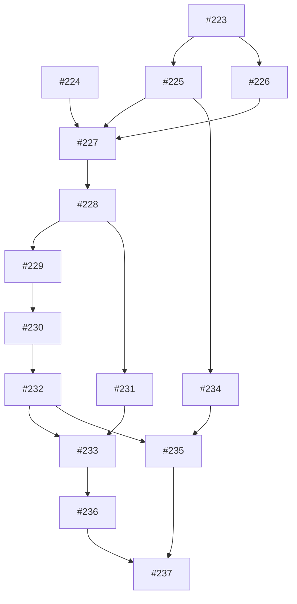

# YouTube 영상 분석 리팩토링 작업 분할안

> **Superseded:** 이 문서는 [#248](https://github.com/100-hours-a-week/KTB4-8th-BE/issues/248)로 대체됐다. 현재 설계와 인수 조건은 #248과 [ADR 0003](adr/0003-in-process-analysis-mysql-coordination.md)을 따른다. 아래 내용은 기록으로만 보존한다.

작성 시점의 작업 분할 기록이다. 체크박스와 게시 상태는 실시간 진행률이 아니며 실제 상태는 GitHub 이슈·PR을 따른다.

부모 명세: [#222](https://github.com/100-hours-a-week/KTB4-8th-BE/issues/222)
상태: 사용자 승인 후 하위 이슈 #223~#237 등록 완료. T번호는 검토안과의 대응을 위해 유지한다.

## 분할 원칙

- T01은 기존 동작을 보존하면서 실제 DB 검증을 가능하게 하는 사전 정리다. 이후에는 클래스/계층별 묶음 대신 공개 업무 경계에서 검증 가능한 흐름으로 나눈다.
- T01~T14는 구현·대역/격리 환경 검증이며 실제 운영 전환이 아니다. 새 경로와 contract migration은 운영 쓰기 차단·데이터 정리·외부 검증 전에 적용하지 않는다.
- 새 구조를 기존 구조 옆에 준비하고, V2/V3 사용처를 전환한 뒤 사용하지 않는 구 구조를 제거한다. 각 작업은 독립 검증이 가능해야 하며 통합 전 운영 라우팅은 유지한다.
- 외부 서버의 실제 지원·운영 DB/데이터·용량·복원 증거는 T15의 완료 조건이다. 앞선 코드 작업은 실행 가능한 계약과 검사 도구를 준비하되 실제 지원이 확인됐다고 취급하지 않는다.
- 15개 하위 이슈를 차단 순서로 생성하고 ready-for-agent 및 native blocking 관계를 적용했다. 부모 #222의 본문·상태·라벨은 변경하지 않는다.

## 작업 개요

| 번호 | GitHub 이슈 | 제목 | 직접 차단 작업 |
|---|---|---|---|
| T01 | [#223](https://github.com/100-hours-a-week/KTB4-8th-BE/issues/223) | Flyway·실제 MySQL 검증을 CI에서 재현 | 없음 |
| T02 | [#224](https://github.com/100-hours-a-week/KTB4-8th-BE/issues/224) | 버전 분석 AI 계약과 전용 HTTP 연동 검증 | 없음 |
| T03 | [#225](https://github.com/100-hours-a-week/KTB4-8th-BE/issues/225) | 유효한 나들이 가이드의 동일성과 원자 재사용 | T01 |
| T04 | [#226](https://github.com/100-hours-a-week/KTB4-8th-BE/issues/226) | 영상별 최신 결과 재사용과 활성 분석 공유 | T01 |
| T05 | [#227](https://github.com/100-hours-a-week/KTB4-8th-BE/issues/227) | 등록한 배치의 분석·복수 결과·임베딩 요청 원자 저장 | T02, T03, T04 |
| T06 | [#228](https://github.com/100-hours-a-week/KTB4-8th-BE/issues/228) | 소유권 만료·늦은 응답·최종 실패의 원자 처리 | T05 |
| T07 | [#229](https://github.com/100-hours-a-week/KTB4-8th-BE/issues/229) | AI 호출 예산·지연 예약·저장 교착상태 재시도 | T06 |
| T08 | [#230](https://github.com/100-hours-a-week/KTB4-8th-BE/issues/230) | 슬롯 제어와 기동·주기적 미완료 작업 복구 | T07 |
| T09 | [#231](https://github.com/100-hours-a-week/KTB4-8th-BE/issues/231) | 고정 분석 ID의 유한 대기·스냅샷·부분 반환 | T06 |
| T10 | [#232](https://github.com/100-hours-a-week/KTB4-8th-BE/issues/232) | 커밋된 신규 Guide 임베딩의 독립 전달·중복 안전성 | T08 |
| T11 | [#233](https://github.com/100-hours-a-week/KTB4-8th-BE/issues/233) | V2·V3 동기화를 새 분석 흐름과 짧은 위시리스트 커밋으로 통합 | T09, T10 |
| T12 | [#234](https://github.com/100-hours-a-week/KTB4-8th-BE/issues/234) | 대표 Guide·분석·위시리스트·코스의 DB 이관 검증 | T03 |
| T13 | [#235](https://github.com/100-hours-a-week/KTB4-8th-BE/issues/235) | 외부 벡터 대표 ID 정리와 DB·벡터 복원 절차 | T10, T12 |
| T14 | [#236](https://github.com/100-hours-a-week/KTB4-8th-BE/issues/236) | 동기화·AI Job 추적과 운영 설정 검증 | T11 |
| T15 | [#237](https://github.com/100-hours-a-week/KTB4-8th-BE/issues/237) | 외부 호환성·쓰기 중단 전환·복원 리허설 통과 | T13, T14 |

## 의존관계

## 등록한 하위 이슈 본문

### T01 / #223 — Flyway·실제 MySQL 검증을 CI에서 재현

**Blocked by:** 없음 — 즉시 시작 가능

## Parent

https://github.com/100-hours-a-week/KTB4-8th-BE/issues/222

## What to build

빈 DB와 기존 스키마 fixture에서 Flyway baseline과 확장을 검증하고, 같은 MySQL 검사를 CI에서 필수 실행할 수 있게 한다. 새 기능의 운영 전환 없이 검증 기반을 먼저 마련하는 사전 정리 작업이다.

명세 추적: 사용자 스토리 43; 필수 검증 시나리오 17.

## Acceptance criteria

- [ ] 기존 스키마의 명시적 baseline과 기존 데이터 보존 검증을 준비한다. 운영 DB 자동 baseline과 운영 데이터 변경을 하지 않는다.
- [ ] 테스트는 Flyway로 스키마를 만들고 실제 MySQL을 사용한다. Hibernate 자동 생성 스키마나 mock 트랜잭션만으로 통과시키지 않는다.
- [ ] MySQL 8.0.17 이상·utf8mb4 연결·utf8mb4_0900_bin 지원을 검사하고 미지원 환경을 명확하게 실패시킨다.
- [ ] 기존 동작을 유지하면서 필요한 새 테이블·컬럼의 추가 migration을 검증할 수 있다. 기존 데이터 정리와 전역 NOT NULL/유일성의 실제 적용은 #234·#237에서 관리한다.
- [ ] CI에서 실제 MySQL 검사가 필수 실행되며 bootJar 성공만으로 대체되지 않는다. 운영 Hibernate validate 전환 절차와 기존 스키마 차이 검사 방법을 남긴다.

### T02 / #224 — 버전 분석 AI 계약과 전용 HTTP 연동 검증

**Blocked by:** 없음 — 즉시 시작 가능

## Parent

https://github.com/100-hours-a-week/KTB4-8th-BE/issues/222

## What to build

영상당 복수 Guide와 명시적 유형의 새 분석 계약을 실행 가능한 요청·응답 테스트로 고정하고, 전용 HTTP 연동이 성공·HTTP 실패·전송 실패 정보를 손실 없이 전달하게 한다.

명세 추적: 사용자 스토리 1, 23, 45; 필수 검증 시나리오 8, 9, 15.

## Acceptance criteria

- [ ] 영상 ID·상태·오류·Guide 목록과 명시적 PLACE/EVENT를 갖는 버전 계약 및 테스트 fixture를 준비한다. SUCCESS는 1개 이상, NOT_FOUND/FAILED는 빈 목록이다.
- [ ] 파싱 실패·ID 누락/중복/미요청 ID·알 수 없는 상태/유형·필수 구조 위반을 INVALID_AI_RESPONSE로 분류한다. 계약상 허용된 후보 필드 누락은 후보 검증에 남긴다.
- [ ] 성공 DTO와 AiRequestException을 구분하고 HTTP status·Retry-After·전송/타임아웃 원인을 보존한다. 오류 본문 파싱 실패가 HTTP 상태 분류를 가리지 않는다.
- [ ] Job 전용 클라이언트의 연결 5초·분석 전체 130초 제한과 남은 Job 기한 반영을 검증한다. 채팅·추천의 공유 클라이언트를 변경하지 않고 숨은 재시도를 제거한다.
- [ ] 실제 URL·wire 필드명을 외부 서버와 맞출 계약 자료 및 실행 가능한 호환성 검사를 준비하고 구계약 fallback을 두지 않는다. 로컬 대역의 성공을 실제 서버 지원 증거로 취급하지 않으며 최종 실제 검증은 #237에서 수행한다.

### T03 / #225 — 유효한 나들이 가이드의 동일성과 원자 재사용

**Blocked by:** T01

## Parent

https://github.com/100-hours-a-week/KTB4-8th-BE/issues/222

## What to build

유효 후보를 장소·행사로 저장하고, 같은 키를 동시에 저장해도 하나의 기존 Guide를 재사용하는 업무 경로를 실제 MySQL에서 검증한다.

명세 추적: 사용자 스토리 16, 17, 18, 19, 20, 21, 22; 필수 검증 시나리오 2, 3, 5.

## Acceptance criteria

- [ ] 유형·원문 이름·도로명주소로 GuideKey·isSameAs·DB 비교를 일치시킨다. trim·대소문자/유니코드 정규화·문자열 절단을 하지 않는다.
- [ ] 정확한 키 충돌은 기존 ID를 반환하고 설명·좌표·기간 등 모든 기존 필드를 보존한다. Place/Event는 구분하고 복수 키는 유형·이름·주소 순서로 저장한다.
- [ ] 이름/주소 null·공백·각 255자 초과, 좌표 누락/비유한/범위 위반, 양쪽 날짜가 있는 역전 기간과 기타 저장 제약 위반을 후보별 제외하고 위치·사유를 남길 수 있다.
- [ ] 기간·영업시간 미상과 한쪽 날짜는 허용한다. 새 행사는 Asia/Seoul 기준 시작일 포함·종료일 다음 날 자정 미포함이며 이용 가능성 비교를 일치시킨다. 기존 행사 기간은 갱신하지 않는다.
- [ ] 동시 동일 키 저장, 기존 필드 보존, Java/MySQL 대소문자·후행 공백·유니코드 및 길이 경계를 실제 MySQL로 검증한다. 최종 제약 migration은 정리 선행 조건을 포함하고 더러운 기존 운영 데이터에 자동 적용하지 않는다.

### T04 / #226 — 영상별 최신 결과 재사용과 활성 분석 공유

**Blocked by:** T01

## Parent

https://github.com/100-hours-a-week/KTB4-8th-BE/issues/222

## What to build

겹치는 영상 입력에서 공유·재사용·신규 등록을 결정하고, 호출이 기다릴 분석 ID를 고정해 반환하는 작업 확보 경로를 완성한다.

명세 추적: 사용자 스토리 2, 3, 4, 5, 6, 7, 8, 9; 필수 검증 시나리오 1, 4, 5, 6.

## Acceptance criteria

- [ ] 기존 영상 적격성 필터·빈 입력을 처리하고 영상 ID를 중복 제거한다. 전체 입력 수에 10개 제한을 두지 않는다.
- [ ] 영상 ID PK의 영구 등록 잠금 행을 정확하게 비교하고 ID 순서로 생성·획득한다. 독립 READ_COMMITTED 트랜잭션의 잠금 아래 재조회가 판단 기준이며 만료/삭제 정책을 추가하지 않는다.
- [ ] 활성 작업을 공유하고 없으면 생성 시각·ID 기준 최신 완료 이력만 본다. SUCCESS의 모든 매핑·NOT_FOUND 빈 결과를 재사용하며 오래된 성공으로 대체하지 않는다.
- [ ] 잠금 아래 처음 확인한 FAILED/이력 없음은 새 분석을 만든다. 이미 고정한 공유 참조가 실패해도 같은 호출에서 대체하지 않는다. 충돌 직후 완료된 고정 참조도 그대로 조회한다.
- [ ] 최대 10개 단위로 신규 Job·배치·분석·활성 등록을 원자 커밋하고 공유/재사용 영상은 새 배치에서 제외한다. 실패한 JPA 트랜잭션을 재사용하지 않는다.
- [ ] 컨텍스트에 확보한 참조를 누적하고 이후 등록 실패 시 예외·추가 등록 중단·이전 커밋 보존을 검증한다. 외부 호출이나 실행기 제출은 등록 트랜잭션에 넣지 않는다.
- [ ] 실제 MySQL에서 겹치는 요청·완료 경쟁·활성 유일성·배치 분할·최신 이력 인덱스를 검증한다.

### T05 / #227 — 등록한 배치의 분석·복수 결과·임베딩 요청 원자 저장

**Blocked by:** T02, T03, T04

## Parent

https://github.com/100-hours-a-week/KTB4-8th-BE/issues/222

## What to build

신규 영상 등록부터 최초 AI 호출, 복수 Guide/영상별 결과/임베딩 요청 저장, 분석 결과 조회까지 한 경로를 끝까지 동작시킨다. 재시도·인계 강화는 후속 작업에서 추가한다.

명세 추적: 사용자 스토리 1, 10, 20, 21, 29, 32, 34; 필수 검증 시나리오 2, 3, 9, 10, 14.

## Acceptance criteria

- [ ] 기존 analyze와 컨텍스트 오버로드로 신규 작업을 등록하고 커밋 후 공통 Job 실행 경계에서 최초 1회 호출한다. 외부 API의 운영 라우팅은 아직 바꾸지 않는다.
- [ ] 공통 Job에 상태·DB 등록 시각·10분 기한·소유자·실행 버전·lease·호출 수를 기록하고 Handler 계약을 통해 분석 실행·종료를 연결한다. 분석 전용 DTO가 공통 실행 계층에 유입되지 않는다.
- [ ] 한 영상의 모든 유효 Guide를 저장·매핑하고 영상별 SUCCESS/NOT_FOUND/FAILED를 함께 확정한다. 모든 후보 제외는 해당 영상 FAILED/INVALID_GUIDE_DATA, 잘못된 응답 구조는 배치 실패다.
- [ ] Job 잠금·실행권·lease·기한을 검증하고 Guide·매핑·영상 상태·활성 해제·신규 Guide당 임베딩 Job/대상·분석 Job 완료를 한 트랜잭션으로 커밋한다.
- [ ] 정상 응답의 영상별 실패가 있어도 모두 저장하면 Job은 COMPLETED다. 실패한 배치와 다른 배치의 성공 커밋을 분리한다.
- [ ] 임베딩 요청은 DB에 남기되 분석 반환이 임베딩 호출/완료를 기다리지 않는다. 일반 요청은 기존 Guide에 임베딩 Job을 만들지 않는다.
- [ ] 실제 MySQL과 AI HTTP 대역으로 등록→호출→결과 조회를 검증하고, 저장 실패 시 Guide·매핑·완료·Outbox가 함께 롤백되는 기본 경계를 확인한다.

### T06 / #228 — 소유권 만료·늦은 응답·최종 실패의 원자 처리

**Blocked by:** T05

## Parent

https://github.com/100-hours-a-week/KTB4-8th-BE/issues/222

## What to build

만료·인계와 저장/실패가 경쟁해도 이전 작업자가 새 상태를 덮어쓰지 못하고, 종료한 작업의 활성 등록이 함께 해제되도록 한다.

명세 추적: 사용자 스토리 25, 29, 31; 필수 검증 시나리오 7, 10, 11.

## Acceptance criteria

- [ ] 모든 결과·실패·heartbeat·활성 해제는 상태·owner·version과 lease > DB now를 검증한다. 만료 토큰의 자가 갱신과 늦은 응답 저장을 차단한다.
- [ ] heartbeat 10초·lease 60초를 설정 가능하게 하고 실행기와 분리해 갱신한다. DB 시간으로 소유권 만료를 판단한다.
- [ ] 저장·인계·기한 초과 종료를 같은 Job 잠금으로 직렬화한다. 기한 내 유효 lease/토큰으로 저장 검증했으면 DB 제한 내 기한 이후 커밋을 허용한다.
- [ ] 저장 잠금 때문에 heartbeat가 대기하는 경우 지연만으로 유효한 저장을 취소하지 않는다. 짧은 DB 작업 3초·저장 10초·lock wait 2초를 실제로 검증한다.
- [ ] 최종 실패는 같은 트랜잭션에서 Handler 업무 종료·미완료 분석 실패·완료 시각·활성 해제·Job 실패를 수행한다. 확정한 분석/매핑은 변경하지 않고 외부 호출/독립 커밋을 하지 않는다.
- [ ] 저장 롤백 후 별도 실패 기록이 실행권을 다시 검증하며 소유권 상실이면 no-op이다. 기록도 실패하면 관측 정보가 남고 후속 복구가 같은 종료 경로를 사용할 수 있다.
- [ ] 실제 MySQL의 저장/종료/인계 경쟁과 늦은 결과·실패·heartbeat·기한 내 검증 후 커밋을 재현한다.

### T07 / #229 — AI 호출 예산·지연 예약·저장 교착상태 재시도

**Blocked by:** T06

## Parent

https://github.com/100-hours-a-week/KTB4-8th-BE/issues/222

## What to build

일시 오류는 제한적으로 다시 호출하고, DB 교착상태는 이미 받은 응답의 저장만 다시 수행하며, 어떤 인계에서도 호출 예산과 기한을 늘리지 않는다.

명세 추적: 사용자 스토리 23, 24, 30; 필수 검증 시나리오 8, 10, 11.

## Acceptance criteria

- [ ] 호출 직전 실행권·기한·예산 검증과 누적 수 증가를 원자 처리한다. 불확실한 전송도 포함하여 총 4회까지만 허용한다.
- [ ] 연결/타임아웃·HTTP 408/429/500/502/503/504만 재시도한다. 나머지 HTTP 오류·잘못된 응답·정상 영상별 실패·후보 검증 실패는 즉시 재호출하지 않는다.
- [ ] 기본 1/2/4초 ±20% jitter, Retry-After 초/HTTP-date 우선, 잘못된 값 fallback·과거값 0·deadline 이상 예약 불가를 검증한다.
- [ ] 재시도 예약은 PENDING 전환·next retry·토큰 무효화를 원자 처리하고 슬롯/heartbeat를 해제한다. Job·최초 기한·예산은 유지한다.
- [ ] 총 4회 소비 후 응답 영속본 없이 복구해야 하면 CALL_BUDGET_EXHAUSTED로 최종 종료하며 응답 영속화는 추가하지 않는다.
- [ ] 교착상태만 동일 응답으로 전체 저장을 최초+최대 2회, 50/100ms ±20% jitter로 재시도한다. 매회 토큰·lease·기한 검증, 소진/다른 저장 오류의 별도 최종 실패, AI 재호출 없음을 확인한다.
- [ ] 공통 정책 한 계층만 재시도하고 분석·임베딩 Handler가 재사용할 수 있다. 실제 DB 교착상태와 외부 호출 수로 예산을 검증한다.

### T08 / #230 — 슬롯 제어와 기동·주기적 미완료 작업 복구

**Blocked by:** T07

## Parent

https://github.com/100-hours-a-week/KTB4-8th-BE/issues/222

## What to build

새 사용자 요청이 없어도 커밋된 대기 Job을 실행하고, 만료 Job을 인계하거나 종료하며, DB에서 용량 대기를 관리한다.

명세 추적: 사용자 스토리 24, 25, 26, 27, 28; 필수 검증 시나리오 6, 7.

## Acceptance criteria

- [ ] 분석 4·임베딩 2의 인스턴스별 슬롯이 있을 때만 실행권을 원자 획득한다. 페이지 조회와 next retry·등록 시각·ID 순서를 사용하고 전체 대기 작업을 메모리에 넣지 않는다.
- [ ] 기동 직후·1초 주기로 실행/소유권 복구/기한 종료를 수행한다. 요청은 wake-up을 제공하고 커밋 후 제출 전 프로세스 종료도 복구한다.
- [ ] 슬롯 대기도 등록부터 10분에 포함한다. 실행 전 기한이 지나면 외부 호출 없이 최종 종료하고 활성 등록을 해제한다.
- [ ] lease 만료 후 기한/예산이 남으면 토큰을 무효화해 PENDING으로 복구한다. 재시도 인계도 등록 시각·호출 예산·기한을 유지한다.
- [ ] worker·heartbeat·dispatch/recovery 실행기를 분리하고 다중 인스턴스의 동일 Job 경쟁을 DB에서 제어한다.
- [ ] 기동/스캔 경계와 실제 MySQL을 사용해 새 요청 없는 복구·용량 부족·기한 초과·다중 소유자·늦은 호출 중첩을 검증한다. 외부 in-flight의 엄격한 전역 상한은 주장하지 않는다.

### T09 / #231 — 고정 분석 ID의 유한 대기·스냅샷·부분 반환

**Blocked by:** T06

## Parent

https://github.com/100-hours-a-week/KTB4-8th-BE/issues/222

## What to build

호출자는 고정한 분석 ID의 결과만 유한하게 기다리고, 시간 초과/인터럽트에는 저장된 부분 결과를, 조회 장애에는 예외를 받는다.

명세 추적: 사용자 스토리 9, 10, 11, 12, 13, 14; 필수 검증 시나리오 12, 13.

## Acceptance criteria

- [ ] 기존 반환형을 유지하고 상위 생성 컨텍스트에 호출 ID·고정 분석/배치/Job ID·생성/공유/재사용 구분과 COMPLETED/WAIT_TIMEOUT/INTERRUPTED를 전달한다.
- [ ] 진입부터 단조 시계 60초 예산을 계산하고 준비/등록 시간을 차감한다. 예산 만료로 남은 입력 등록을 생략하지 않으며 전체 메서드/HTTP 60초 SLA로 표현하지 않는다.
- [ ] 500ms polling과 최종 조회의 같은 스냅샷에서 상태·매핑·재사용/성공 결과를 확정한다. GuideKey 중복 제거·순서 비보장·빈 결과를 처리하고 조회 뒤 커밋 결과를 끼워 넣지 않는다.
- [ ] COMPLETED는 모두 종료되었다는 의미이며 모두 성공했다는 뜻이 아니다. 시간 초과 시 부분 결과와 WAIT_TIMEOUT을 반환하고 worker를 취소하지 않는다.
- [ ] 인터럽트 시 새 blocking 조회 없이 마지막 성공 결과를 사용하고 INTERRUPTED·호출자 interrupt flag를 보존한다. 연결 종료/대기 취소도 Job 취소로 전파하지 않는다.
- [ ] 조회는 최초+재시도 2회, 100/200ms로 제한하고 소진 시 캐시된 부분/빈 목록 대신 예외를 전달한다. 커밋된 분석과 진행 Job은 유지한다.
- [ ] 분석기 진입점에서 시간·스냅샷·조회 장애·인터럽트·취소 분리를 재현 가능한 테스트로 검증한다.

### T10 / #232 — 커밋된 신규 Guide 임베딩의 독립 전달·중복 안전성

**Blocked by:** T08

## Parent

https://github.com/100-hours-a-week/KTB4-8th-BE/issues/222

## What to build

분석 저장에 남긴 임베딩 Job을 별도로 실행하여 Guide ID로 upsert하고, 실패해도 분석 결과와 반환을 유지한다.

명세 추적: 사용자 스토리 32, 33, 34, 35; 필수 검증 시나리오 14, 15.

## Acceptance criteria

- [ ] 커밋된 신규 Guide당 한 Job/대상을 처리하며 Place/Event 모두 같은 전달 경계를 사용한다. 기존 Guide는 일반 요청에서 재임베딩하지 않는다.
- [ ] Job 전용 HTTP 연동에 연결 5초·임베딩 전체 30초·남은 기한 제한을 적용하고 공통 슬롯/lease/호출 예산/재시도/기동 복구를 사용한다.
- [ ] Guide ID를 외부 키로 upsert하며 중복 요청에도 벡터가 중복 생성되지 않는 계약과 실행 가능한 검사를 준비한다.
- [ ] 성공 응답이 실제 저장 완료를 의미할 때만 Job을 완료한다. 단순 접수만 지원하면 미지원으로 기록하고 별도 polling 프로토콜이나 구계약 fallback을 추가하지 않는다.
- [ ] 재시도 소진/영구 실패는 Job에 보존하고 분석 결과·영상 상태·위시리스트를 변경하지 않는다. analyze는 임베딩 완료를 기다리지 않는다.
- [ ] 공통 실행 경계와 HTTP 대역으로 지연·중복·응답 유실·최종 실패·재시작을 검증한다. 실제 서버 upsert/완료 증거는 #237에서 확인한다.

### T11 / #233 — V2·V3 동기화를 새 분석 흐름과 짧은 위시리스트 커밋으로 통합

**Blocked by:** T09, T10

## Parent

https://github.com/100-hours-a-week/KTB4-8th-BE/issues/222

## What to build

기존 V2·V3 plain API가 같은 분석기를 사용하면서 대기 트랜잭션을 제거하고, 완료 결과를 독립적으로 위시리스트에 반영한다.

명세 추적: 사용자 스토리 15, 36, 37; 필수 검증 시나리오 13, 15.

## Acceptance criteria

- [ ] YouTube 조회·분석 대기를 상위 트랜잭션 밖으로 옮기고 위시리스트 반영만 별도 짧은 트랜잭션으로 처리한다. 컨텍스트는 상위 코드가 생성한다.
- [ ] V2의 직접 Guide 저장·동기 임베딩을 새 흐름으로 통합하고 전체 생성 경로·isSameAs 사용처를 조사/전환한다. 불필요해진 구 구현은 사용처가 없어졌을 때 제거한다.
- [ ] 위시리스트 실패가 분석/Outbox 커밋을 되돌리지 않고 다음 동기화에서 성공 이력을 재사용한다.
- [ ] 늦게 완료된 Guide는 다음 동기화에서 반영한다. background Job이 위시리스트를 수정하지 않으며 다음 동기화가 없으면 자동 반영하지 않는다.
- [ ] 기존 외부 경로·HTTP 응답을 유지하고 기존 성공 응답이 모든 분석/반영 완료를 뜻하지 않음을 API 계약에 명시한다. 새 응답 DTO·상태 조회 API·SSE를 구현하지 않는다.
- [ ] V2·V3 HTTP 경계에서 기존 응답·부분 결과·연결 종료·독립 커밋·후속 재사용을 검증한다. 실제 운영 라우팅/쓰기 전환은 #237 전환 조건 충족 전 수행하지 않는다.

### T12 / #234 — 대표 Guide·분석·위시리스트·코스의 DB 이관 검증

**Blocked by:** T03

## Parent

https://github.com/100-hours-a-week/KTB4-8th-BE/issues/222

## What to build

기존 데이터의 문제를 사전 보고하고, 중복 Guide를 대표로 정리해도 회원 참조와 이력이 보존되는 이관·제약 적용 경로를 실제 MySQL에서 완성한다.

명세 추적: 사용자 스토리 38, 40, 41, 43; 필수 검증 시나리오 16, 17.

## Acceptance criteria

- [ ] 모든 Guide 참조/쓰기 경로·null/공백/길이 초과·중복과 대상 ID/참조 수를 보고하는 읽기 전용 preflight를 제공한다.
- [ ] 정확한 유형·이름·주소별 최소 ID를 대표로 고정하고 old→canonical 매핑을 영속화한다. 대표 필드를 병합/갱신하지 않는다.
- [ ] 분석 매핑은 대표 ID로 중복 제거해 재생성한다. 코스 stop은 순서/개수를 유지하고 FK만 치환한다. 활성 위시리스트는 회원·대표별 최소 ID 하나를 유지하고 나머지를 삭제 처리하며 기존 삭제 이력/행 ID를 보존한다.
- [ ] 잘못된 데이터는 자동 삭제/임의 정정/문자열 절단하지 않는다. 검증된 정정 목록과 미해결 0건을 제약 적용 조건으로 두고 실패 경로를 테스트한다.
- [ ] 실제 대상 스키마와 Flyway baseline을 비교 검증하고, 정리 후 이름/주소 VARCHAR(255)·utf8mb4_0900_bin·NOT NULL·복합 유일성과 참조 제약을 적용하는 migration을 준비한다.
- [ ] 구버전 정지 이후 실행할 LEGACY_MIGRATION 종료 절차를 제공한다. 기존 IN_PROGRESS만 FAILED로 종료하고 과거 완료 이력/배치 없는 과거 분석을 보존하며 새 Job으로 복원하지 않는다.
- [ ] 정리 전후 fixture·두 번 적용 시 안전한 중단/재개 조건·FK/매핑/삭제 이력/코스 정합성을 실제 MySQL로 검증한다. 이 티켓은 운영 데이터에 직접 실행하지 않는다.

### T13 / #235 — 외부 벡터 대표 ID 정리와 DB·벡터 복원 절차

**Blocked by:** T10, T12

## Parent

https://github.com/100-hours-a-week/KTB4-8th-BE/issues/222

## What to build

DB의 대표 Guide 매핑에 맞춰 외부 검색 결과도 정리하고, DB와 벡터를 함께 되돌릴 수 있는 일회성 이관·복원 절차를 검증한다.

명세 추적: 사용자 스토리 39, 42; 필수 검증 시나리오 16, 17.

## Acceptance criteria

- [ ] #234의 old→canonical 매핑을 소비해 중복 벡터 ID를 정리하고 대표 Guide ID의 존재/검색 가능성을 검증한다. 삭제한 구 ID가 검색 결과에 남지 않는다.
- [ ] 대표 필드는 DB 기준으로 보존하며 일회성 정리는 일반 분석의 기존 Guide 재임베딩이나 상시 운영 재처리 도구와 구분한다.
- [ ] 외부 저장소의 실제 제공 기능을 사전 확인하는 검사와 지원 불가 시 중단 경로를 준비한다. 테스트 대역 성공만으로 운영 지원을 확인했다고 처리하지 않는다.
- [ ] DB/벡터의 정리 전 백업과 일관된 복원 순서·부분 실패 시 중단/재개 절차를 문서화하고 격리된 환경에서 검증한다.
- [ ] 대표 매핑·참조·검색 결과가 일치한다는 전후 보고서 및 복원 검사를 남긴다. 실제 운영 기능/권한과 복원 증거의 최종 확인은 #237에서 수행한다.
- [ ] 정리 이후 비호환 구버전 바이너리만 재배포하는 롤백을 허용하지 않는 조건을 실행 절차에 포함한다.

### T14 / #236 — 동기화·AI Job 추적과 운영 설정 검증

**Blocked by:** T11

## Parent

https://github.com/100-hours-a-week/KTB4-8th-BE/issues/222

## What to build

요청에서 공유·재시도·인계·종료·부분 반환까지 연결해 추적하고, 유형별 대기·실패·기한·임베딩 누락을 운영자가 관측할 수 있게 한다.

명세 추적: 사용자 스토리 44; 필수 검증 시나리오 8, 12, 14, 15.

## Acceptance criteria

- [ ] 호출/Job/배치/분석 ID·실행 버전·실패 코드를 컨텍스트와 worker 전환에서도 연결해 로그에 남긴다. 한 Job을 공유하는 여러 호출을 혼동하지 않는다.
- [ ] 활성 수·유형별 PENDING/대기 시간/실행 수·기한 초과·인계·AI 호출/재시도·저장 교착상태/재시도·heartbeat 실패·대기 중단·조회 장애·임베딩 최종 실패를 관측한다.
- [ ] 부모 명세의 모든 초기 설정을 외부 설정으로 제공하고 잘못된 값과 실제 HTTP/DB 제한을 검증한다. 운영 SLA가 확인된 값으로 표시하지 않는다.
- [ ] 성공·공유·영구 실패·재시도·인계·WAIT_TIMEOUT·INTERRUPTED·DB 조회 장애·임베딩 실패를 실행해 운영자가 원인을 구분할 수 있음을 확인한다.
- [ ] 프록시/LB 제한·AI 지연/용량 측정과 배포값 점검을 실행할 자료를 준비한다. 실제 환경 적합성 결과는 #237의 배포 조건으로 남긴다.

### T15 / #237 — 외부 호환성·쓰기 중단 전환·복원 리허설 통과

**Blocked by:** T13, T14

## Parent

https://github.com/100-hours-a-week/KTB4-8th-BE/issues/222

## What to build

통합된 구현을 실제 외부 계약과 대상 환경에서 검증하고, 짧은 쓰기 중단을 사용하는 배포/복원 절차의 통과 증거를 남긴다. 구현 완료를 실제 운영 배포와 혼동하지 않는다.

명세 추적: 사용자 스토리 41, 42, 43, 45; 필수 검증 시나리오 15, 16, 17.

## Acceptance criteria

- [ ] 실제 AI 버전 URL·wire 계약·복수 응답·유형/ID 대응 및 오류 구조를 검사한다. 임베딩 중복 upsert와 성공 응답 후 실제 저장/검색 가능성을 확인한다. 미지원이면 미통과로 남긴다.
- [ ] 운영 대상 MySQL 버전/컬럼/collation·전체 참조/쓰기 경로·정정 목록·미해결 0건과 실제 Java/DB 비교를 검증한다. 테스트 환경 성공으로 대체하지 않는다.
- [ ] 프록시/LB 제한·실제 AI 지연/용량·DB 잠금/timeout을 측정해 합의한 기본값의 배포 적합성을 확인하고 필요한 설정값 조정을 기록한다.
- [ ] 관련 동기화/Guide 쓰기 차단→구버전 작업자 정지→진행 이력 종료→DB/참조/벡터 정리→Flyway/제약 검증→호환 버전 실행→검증 후 쓰기 재개를 운영과 동등한 격리 환경에서 리허설한다.
- [ ] DB와 벡터의 백업·복원 및 실패 시 쓰기 차단 유지/호환 버전 수정/검증한 복원 경로를 리허설한다. 구버전 바이너리만 재배포하는 롤백은 제외한다.
- [ ] V2·V3 분석기·공통 Job 복구·HTTP·Flyway/이관의 네 확정 경계와 다중 인스턴스 전체 회귀 검사를 CI에서 통과한다.
- [ ] 외부 계약·DB·데이터·용량·쓰기 차단·복원·CI 각각의 증거와 통과 여부를 기록한다. 접근할 수 없는 환경이나 미확인 지원은 완료로 표시하지 않고 차단 사유를 남긴다.
- [ ] 이 티켓의 검증 완료는 실제 운영 전환 실행을 뜻하지 않는다.

## 명세 추적 검사

- 사용자 스토리 1~45 및 필수 검증 시나리오 1~17을 모두 하위 작업에 연결했다.
- 직접 차단 관계만 기재했으며 순환·중복된 간접 차단 관계가 없어야 한다.
- 최초 의존관계에서 차단 작업이 없는 항목은 T01·T02다. 실제 완료·착수 가능 상태는 GitHub 이슈와 병합된 PR에서 확인한다. 구현 코드 작업의 완료와 외부 운영 검증의 완료를 구분한다.
