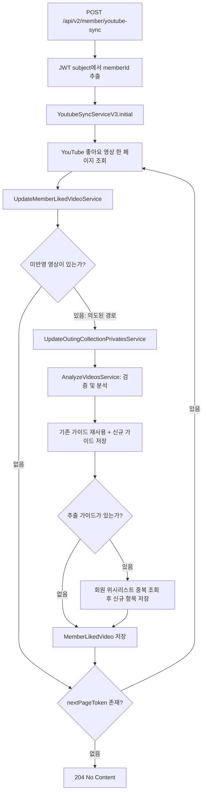
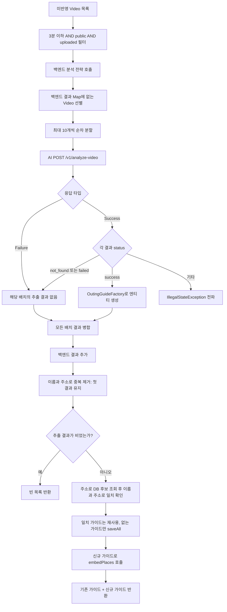
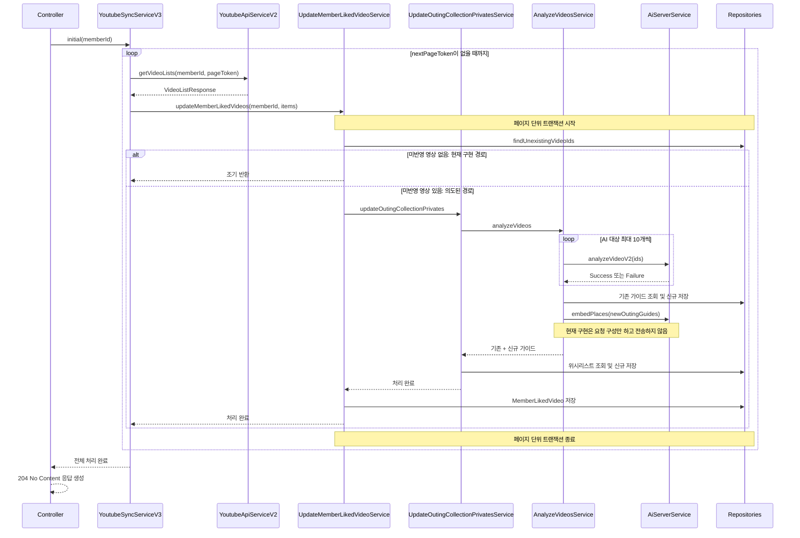

# 유튜브 영상 분석 API 서비스 처리 흐름

분석 기준: 2026-10-20 작업 트리의 Java 소스. 대상은 `eightjbbm.keepgo.interestextraction.service.youtubeanalyze`의 8개 타입이며, API 진입점과 외부 호출·저장소 구현을 함께 확인했다. 아래의 정상 처리 흐름은 서비스가 의도한 파이프라인이다. **현재 구현에서는 신규 영상 선별 조건의 모순으로 분석 단계에 도달하지 못한다.** 코드 수정 없이 관찰 결과를 문서화했다.

## 1. API 진입점과 클래스 역할

`POST /api/v2/member/youtube-sync` → JWT subject를 `Long memberId`로 변환 → `YoutubeSyncServiceV3.initial(memberId)` 호출 → 전체 페이지 처리 완료 후 `204 No Content`. 분석 결과를 응답 본문으로 반환하지 않고 DB에 반영한다. 처리 중 전파된 예외가 있으면 이 정상 응답까지 진행하지 않는다.

| 타입 | 역할 및 다음 호출 |
| --- | --- |
| `YoutubeSyncServiceV3` | 좋아요 영상 페이지를 순차 조회하고 `UpdateMemberLikedVideoService` 호출. 다음 토큰이 없을 때 종료 |
| `UpdateMemberLikedVideoService` | 미반영 영상을 선별하고 위시리스트 처리 후 `MemberLikedVideo` 저장 |
| `UpdateOutingCollectionPrivatesService` | 영상 분석 후 회원 위시리스트에 없는 가이드만 저장 |
| `AnalyzeVideosService` | 영상 검증, 백엔드/AI 분석, 결과 중복 제거, 기존 가이드 재사용 및 신규 가이드 저장 |
| `YoutubeAnalyzeService` | 백엔드 분석 전략 인터페이스. `Map<Video, OutingGuide>` 반환 |
| `NoopAnalyzeService` | 항상 빈 Map을 반환하는 현재 백엔드 분석 전략 |
| `YoutubeAnalyzeServiceConfig` | `NoopAnalyzeService`를 `YoutubeAnalyzeService` Bean으로 등록 |
| `GuideKey` | 분석 결과 중복 제거 키: 가이드 이름 + `Address` 값 |

## 2. 전체 서비스 흐름

**현재 실행 경로:** `findUnexistingVideoIds`는 DB에 저장된 영상 중 **현재 페이지 ID 목록에 없는 ID**를 반환한다. 이후 서비스는 현재 페이지 영상 중 그 반환 ID에 포함되는 영상만 선택한다. 두 집합이 서로 배타적이므로, 저장소가 해당 JPQL대로 정상 실행되는 한 `unupdatedVideos`는 항상 비어 있다. 따라서 위 도식에서 ‘없음’ 경로만 지나며, 분석·위시리스트·좋아요 이력 저장이 모두 생략된다. 최초 사용자도 DB 조회 결과가 비어 같은 경로를 따른다.

## 3. 분석 단계 상세 흐름

다음은 `AnalyzeVideosService.analyzeVideos`가 호출되었을 때의 구현 흐름이다.

1. **검증:** ISO-8601 duration을 `Duration.parse`로 읽어 3분 이하인지 검사한다. 공개 상태 `public`, 업로드 상태 `uploaded` 조건도 모두 만족해야 한다. 잘못된 duration이나 누락 필드는 별도 복구 처리 없이 예외로 이어질 수 있다.
2. **백엔드 우선 분석:** 인터페이스로 전략을 호출하고, 결과 Map에 없는 영상만 AI 대상으로 넘긴다. 현재 Bean은 `NoopAnalyzeService`이므로 검증을 통과한 모든 영상이 AI 대상이다.
3. **AI 분석:** 영상 ID를 최대 10개씩 나눠 순차 호출한다. `AiServerService`가 각 ID를 `https://youtube.com/shorts/{id}`로 변환한다. 병렬 처리나 재시도는 이 경로에 구현되어 있지 않다.
4. **결과 변환:** 응답의 개별 `status=success`만 변환한다. Factory는 카테고리 `팝업`, `전시`를 `OutingEvent`, 나머지를 `OutingPlace`로 만든다. `not_found`, `failed`는 건너뛴다.
5. **중복 및 저장:** AI 결과 뒤에 백엔드 결과를 붙이고 `GuideKey(name, address)`로 첫 결과만 남긴다. 주소로 DB 후보를 조회한 다음 `isSameAs`의 이름·주소 일치 조건으로 기존 엔티티를 재사용한다. 기존 엔티티의 설명·좌표 등을 갱신하지는 않는다.
6. **위시리스트 반영:** 반환된 가이드 중 해당 회원의 위시리스트에 없는 것만 `OutingCollectionPrivate`로 저장한다. 이후 상위 서비스가 미반영 영상 전체를 `MemberLikedVideo`로 저장한다.

## 4. 호출 순서와 트랜잭션 경계

- `YoutubeSyncServiceV3.initial`에는 `@Transactional`이 없다. 페이지마다 호출되는 `UpdateMemberLikedVideoService`에서 트랜잭션이 시작된다.
- `UpdateOutingCollectionPrivatesService`, `AnalyzeVideosService`도 `@Transactional`이며 별도 전파 옵션이 없다. 일반적인 Spring 프록시 호출 및 기본 `REQUIRED` 설정에서 같은 페이지의 트랜잭션에 참여한다.
- AI 분석은 동기 `RestClient.exchange`로 수행되므로 해당 페이지의 DB 트랜잭션 범위 안에서 외부 응답을 기다린다. 코드 주석의 비동기·논블로킹 처리는 구현된 기능이 아니다.
- 후속 페이지에서 예외가 발생해도 앞서 완료된 페이지의 커밋까지 함께 취소되지는 않는다. 외부 AI 처리 역시 DB 롤백 대상이 아니다.

## 5. 현재 구현에서 해석에 주의할 사항

| 항목 | 코드에서 확인한 동작 및 영향 |
| --- | --- |
| 신규 영상 선별 | JPQL의 `m.videoId not in :videoIdList`와 서비스의 `contains(video.getId())`가 모순된다. 분석 파이프라인 진입을 막는 직접 원인이다. 신규 영상은 현재 페이지 ID에서 이미 저장된 ID를 제외하는 방식으로 선별해야 한다. |
| 임베딩 호출 | `embedPlaces`는 `post().uri().body()`에서 끝난다. `retrieve`/`exchange` 등 실행 연산이 없어 HTTP 요청을 전송하지 않는다. 도식의 메서드 호출을 임베딩 완료로 해석하면 안 된다. |
| 좋아요 이력의 의미 | 선별 문제를 수정하더라도 필터 탈락·AI Failure·개별 실패로 가이드가 하나도 없어도 상위 서비스는 해당 미반영 영상을 이력에 저장한다. 따라서 이력은 분석 성공을 뜻하지 않으며, 재실행 시 자동 재분석 대상에서 빠질 수 있다. |
| AI 오류 | HTTP 200은 Success, 400/422/429/500/502/504는 Failure로 역직렬화한다. Failure는 빈 분석 결과로 처리한다. 그 외 HTTP 상태는 RuntimeException, 예상하지 못한 개별 결과 상태는 IllegalStateException이다. 전송·변환 오류도 이 서비스에서 복구하지 않는다. |
| 페이지 크기 | 서비스 주석에는 최대 50개라고 쓰여 있지만 실제 YouTube 요청에 `setMaxResults(50)`은 없다. 실제 페이지 크기를 50으로 보장하지 않는다. |
| 동기 처리 | 페이지 조회 → 분석 배치 → 저장 순서로 진행하며, 전체 작업 완료 후 응답한다. 별도 작업 큐·비동기 실행·재시도는 이 경로에 없다. |
| 최신화 범위 | 기존 가이드 속성 갱신, 좋아요 취소 이력 삭제, 위시리스트 삭제는 이 경로에 없다. 새 항목을 추가하고 기존 가이드를 재사용하는 구조다. |

## 6. 소스 근거

문서 위치를 기준으로 한 상대 링크다.

- [API 컨트롤러](../src/main/java/eightjbbm/keepgo/interestextraction/controller/v2/InterestExtractionControllerV2.java)
- [페이지 순회](../src/main/java/eightjbbm/keepgo/interestextraction/service/youtubeanalyze/YoutubeSyncServiceV3.java)
- [좋아요 이력 처리](../src/main/java/eightjbbm/keepgo/interestextraction/service/youtubeanalyze/UpdateMemberLikedVideoService.java)
- [위시리스트 처리](../src/main/java/eightjbbm/keepgo/interestextraction/service/youtubeanalyze/UpdateOutingCollectionPrivatesService.java)
- [검증·분석·가이드 저장](../src/main/java/eightjbbm/keepgo/interestextraction/service/youtubeanalyze/AnalyzeVideosService.java)
- [분석 전략 인터페이스](../src/main/java/eightjbbm/keepgo/interestextraction/service/youtubeanalyze/YoutubeAnalyzeService.java), [현재 전략](../src/main/java/eightjbbm/keepgo/interestextraction/service/youtubeanalyze/NoopAnalyzeService.java), [Bean 설정](../src/main/java/eightjbbm/keepgo/interestextraction/service/youtubeanalyze/YoutubeAnalyzeServiceConfig.java)
- [중복 제거 키](../src/main/java/eightjbbm/keepgo/interestextraction/service/youtubeanalyze/GuideKey.java)
- [YouTube API 호출](../src/main/java/eightjbbm/keepgo/interestextraction/repository/youtubeanalyze/YoutubeApiServiceV2.java)
- [좋아요 이력 JPQL](../src/main/java/eightjbbm/keepgo/interestextraction/repository/memberlike/MemberLikedVideoRepository.java)
- [AI 호출 및 임베딩](../src/main/java/eightjbbm/keepgo/sandbox/aiv2/AiServerService.java)
- [결과 엔티티 변환](../src/main/java/eightjbbm/keepgo/sandbox/OutingGuideFactory.java), [기존 가이드 동일성](../src/main/java/eightjbbm/keepgo/recommendation/entity/OutingGuide.java), [주소 값 타입](../src/main/java/eightjbbm/keepgo/sandbox/ds/Address.java)

검증 범위: 정적 소스 및 호출 관계 확인. API 실행·DB 쿼리 실행·외부 AI/YouTube 연동 테스트는 수행하지 않았다.
